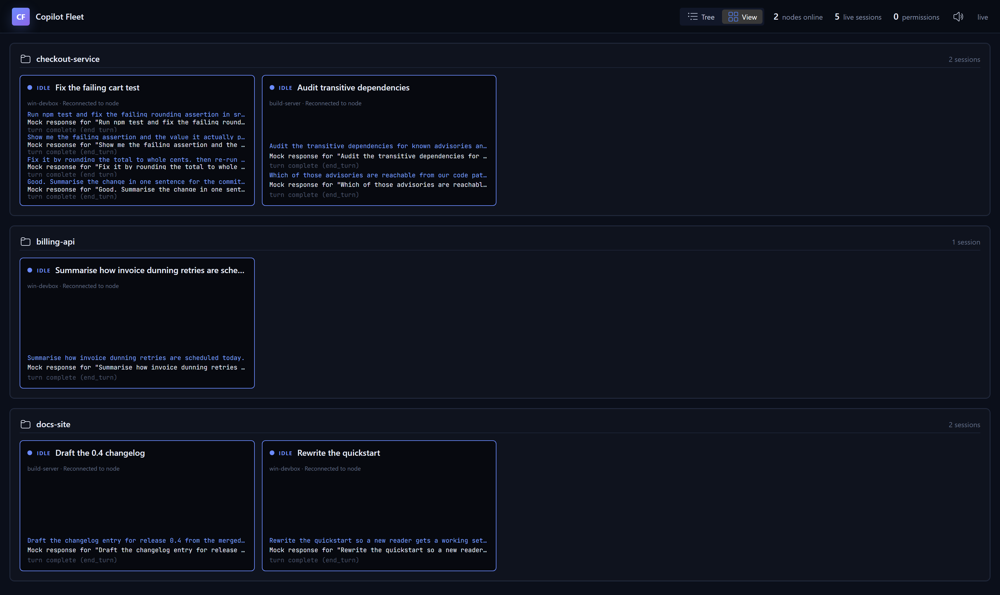
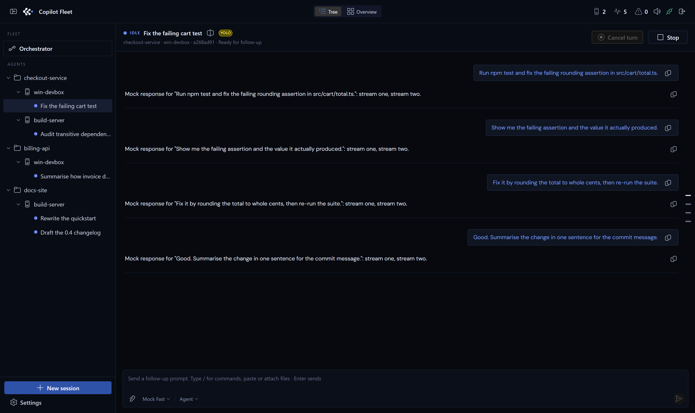
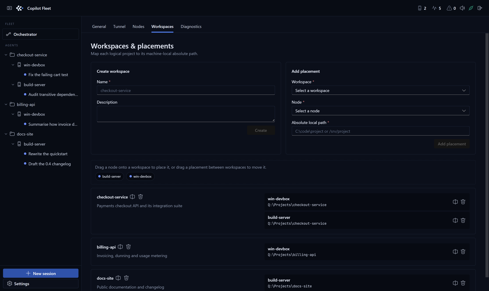
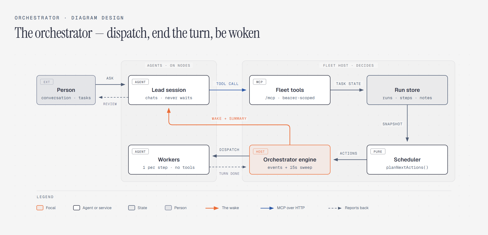
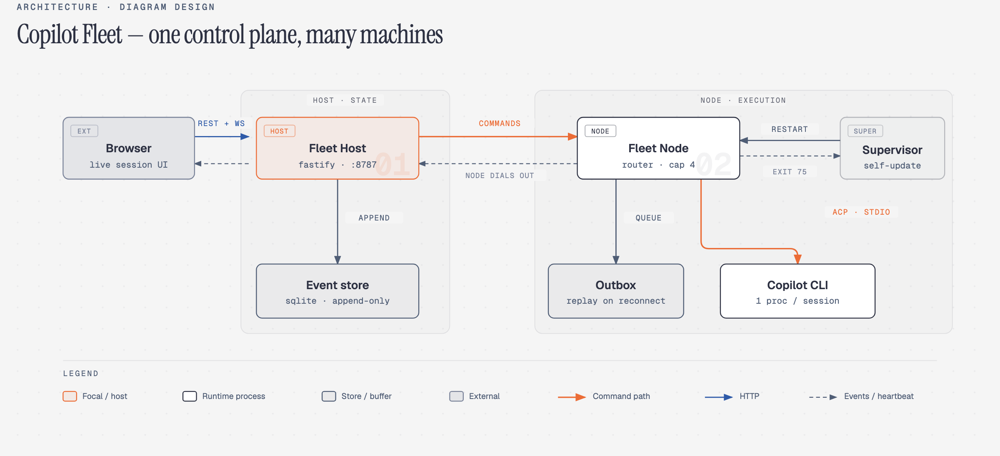

<div align="center">

<picture>
  <source media="(prefers-color-scheme: dark)" srcset="docs/assets/copilot-fleet-mark-dark.svg" />
  
</picture>

# Copilot Fleet

**在你所有的机器上运行 GitHub Copilot CLI 代理，并在同一个屏幕上看着它们工作。**

自托管 · 每台机器只需一条向外的连接 · Copilot 登录凭据从不离开它所在的机器


[English](README.md) · **简体中文**

[快速开始](#快速开始) · [功能](#功能) · [工作原理](#工作原理) · [文档](docs/guide/README.md) · [完整中文参考](docs/zh-CN/reference.md)

**[▶ 在 VibeHub 上试玩交互式演示](https://vibehub.microsoft.com/app/copilot-fleet/)**：真实界面连接模拟的机群，直接在浏览器中运行（需要 Microsoft 登录）

<br />



</div>

---

Copilot Fleet 是一个控制平面，用来管理分布在笔记本、Dev Box 和构建服务器上的
Copilot CLI 代理。**Host** 保存状态并提供 Web 界面；每个 **Node** 主动连接 Host，
并为每个会话运行一个独立的 Copilot 进程。你可以在任意机器上启动会话、实时查看
每段对话、回应权限请求，还可以让 Orchestrator 把大目标拆分给多个 worker。

## 功能

<table>
<tr>
<td width="50%" valign="middle">

### 随时查看完整对话

打开任意卡片即可看到完整对话、支持斜杠命令和附件的输入框，以及代理自带的
Model 和 Mode 选择器。

[使用 Fleet 界面 →](docs/guide/using-fleet.md)

</td>
<td width="50%"></td>
</tr>
<tr>
<td width="50%" valign="middle">

### 一条命令接入任意机器

生成一次性连接命令，在目标机器上运行，它就加入了 fleet。Node 主动向外连接，
不需要开放任何入站端口。

[连接 Node →](docs/guide/nodes.md)

</td>
<td width="50%"></td>
</tr>
<tr>
<td width="50%" valign="middle">

### 一个项目，多处检出

工作区（workspace）是逻辑项目；放置（placement）把它映射到每台机器上的真实路径，
所以会话总是在你批准过的目录里启动。

[快速入门 →](docs/guide/getting-started.md#first-run-walkthrough)

</td>
<td width="50%"></td>
</tr>
<tr>
<td width="50%" valign="middle">

### 会分派任务的 Orchestrator

给主控代理一个目标。它规划阶段、把 worker 分派到各个 Node，并在它们完成时被唤醒。
最终结果由你审阅。

[编排 →](docs/guide/orchestration.md)

</td>
<td width="50%"></td>
</tr>
<tr>
<td width="50%" valign="middle">

### PR 维护

登记一个 Pull Request 并批准修复范围后，主控会持续检查评审和 CI，并让原来的
worker 回去修复发现的问题。

[PR 维护 →](docs/guide/orchestration.md#pr-maintenance-opt-in-pilot)

</td>
<td width="50%"></td>
</tr>
<tr>
<td width="50%" valign="middle">

### 随处访问

在设置里开启 Dev Tunnels、Cloudflare、Tailscale Funnel 或 ngrok；用 Microsoft
登录控制谁可以操作这个 fleet。

[登录与远程访问 →](docs/guide/sign-in-and-access.md)

</td>
<td width="50%"></td>
</tr>
</table>

**还包括：**

- **[Node 自动更新](docs/guide/operations.md#keeping-nodes-up-to-date)**：在 Nodes 页选择 **Update** 或 **Update all**，由 supervisor 在新构建上重启 Node。
- **[重启不丢会话](docs/guide/operations.md#recovering-sessions-after-a-restart)**：Node 断线期间缓存事件，被中断的会话可以恢复。
- **[Host MCP 转发](docs/guide/mcp-and-agency.md#host-authenticated-mcp-forwarding)**：把 Host 上已认证的 MCP（如 Figma）共享给所有 Node。
- **[Agency 模式](docs/guide/mcp-and-agency.md#agency-mode)**：面向微软员工，让整个 fleet 通过 `agency copilot` 启动会话。
- **[Chats](docs/guide/using-fleet.md#chats)**：不需要代码检出的会话，用于提问和调研。
- **[本地代理](docs/guide/orchestration.md#local-agents-handing-work-to-an-orchestrator-from-this-machine)**：从本机的代理把工作交给 Orchestrator。
- **[Windows 登录自启动](docs/guide/nodes.md#windows-login-startup)**：登录 Windows 后自动启动 Host 和 Node。
- **[备份、恢复与迁移](docs/guide/operations.md#moving-a-host-or-a-node-to-another-machine)**：把 Host 或 Node 搬到另一台机器。

## 快速开始

需要 [Node.js](https://nodejs.org/en/download) 22.5+、npm 10+、Git，以及在每台运行代理的机器上
已登录的 [GitHub Copilot CLI](https://docs.github.com/en/copilot/how-tos/copilot-cli/set-up-copilot-cli/install-copilot-cli) 1.0.69+。

**1. 启动 Host**

```bash
git clone https://github.com/charlesyin_microsoft/copilot-fleet.git
cd copilot-fleet
npm install
cp .env.example .env    # PowerShell: Copy-Item .env.example .env
npm run build
npm run start:host
```

**2. 认领。** 打开 `http://127.0.0.1:8787`，输入 Host 在控制台打印的一次性代码。
使用 Microsoft 登录，或者选择不登录（仅限本机或私有隧道访问）。

**3. 连接机器。** 在 **Settings → Nodes** 中选择 **Generate a connect command**，
然后在那台机器的 Fleet 检出目录里运行它。远程机器需要先在 **Settings → Tunnel** 开启隧道。

**4. 添加工作区。** 在 **Settings → Workspaces** 中创建工作区，并添加一个
placement：该 Node 上已存在的文件夹。

**5. 启动会话。** 选择 **New session**，写下提示词，然后看着它实时输出。

> [!TIP]
> 还没有 Copilot 登录？用 `--mock-agent` 连接 Node，就能用确定性的模拟代理体验整个界面。
> 参见[免登录演示](docs/guide/getting-started.md#exact-proof-of-concept)。

[完整流程](docs/guide/getting-started.md)涵盖开发模式、设置向导、隧道和故障排查。

## 工作原理



Host 负责期望状态和历史，Node 负责执行。Copilot 凭据、子进程和本地路径从不离开
Node，并且总是由 Node 发起连接。

- Node 用一次性授权注册并固定 Host 指纹。连接经过签名并端到端加密，隧道只能转发、无法读取。
- 每个会话都是独立的 Copilot CLI 进程，通过 [Agent Client Protocol](https://agentclientprotocol.com) 驱动。
- 事件带有按会话递增的序号。Node 离线时缓存事件，重连后重放。

更多：[工作原理](docs/guide/how-it-works.md) · [ARCHITECTURE.md](ARCHITECTURE.md) ·
[安全模型](docs/guide/security.md)

## 文档

详细指南目前为英文：[docs/guide](docs/guide/README.md)。原中文 README 的完整内容保存在
[docs/zh-CN/reference.md](docs/zh-CN/reference.md)，如与英文指南有出入，以英文为准。

## 开发

```bash
npm run dev       # Host + 界面 + 本地 Node，支持热重载
npm test          # 单元测试和集成测试
npm run verify    # lint、格式、类型、测试，然后生产构建
```

推送前请运行 `npm run verify`。监听模式、端到端浏览器测试和基准测试见
[Development](docs/guide/development.md)。
