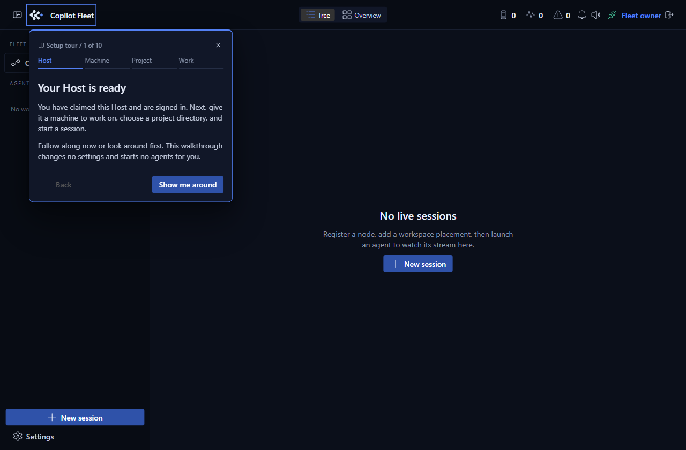
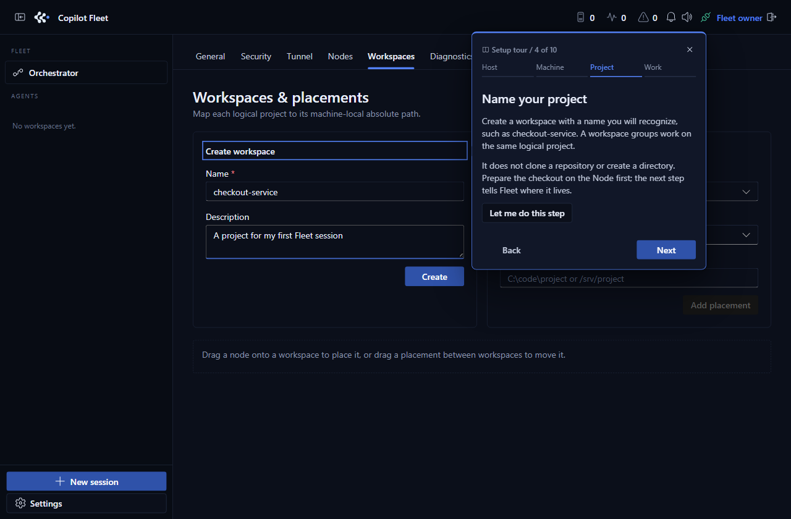
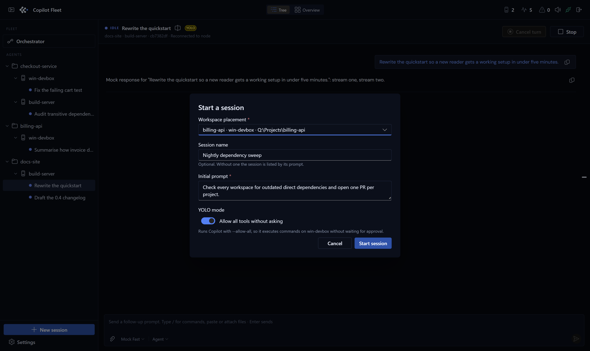

# Getting started

[← README](../../README.md) · [Guide index](README.md)

Install the Host, claim it, enroll your first Node, and run the no-login demo.

## Requirements

- [Node.js](https://nodejs.org/en/download) 22.5 or newer, npm 10 or newer, and Git
- [GitHub Copilot CLI](https://docs.github.com/en/copilot/how-tos/copilot-cli/set-up-copilot-cli/install-copilot-cli)
  1.0.69 or newer installed and authenticated on each real Node, with Copilot
  access permitted by your subscription and organization
- An existing absolute local directory for every workspace placement on the Node
  that will run it
- Optional: an approved publisher- or operator-owned Microsoft app registration
  if you enable Host sign-in; see [registration and account support](sign-in-and-access.md#microsoft-sign-in-registration-and-account-support).
  Setup can instead use no Fleet login with local access or private Dev Tunnels.
- Optional but recommended for multi-machine access: Microsoft Dev Tunnels
  (`devtunnel`) signed in on the Host and, for private tunnels, on each remote
  Node that will dial through it

## Set up the Host (Windows, macOS, Linux)

The Host can run on Windows, macOS, or Linux. A Node may be the same machine as
the Host or a separate machine; the Node is the side that owns working
directories and Copilot authentication.

Clone the intended private repository with an account that can read it:

```bash
git clone https://github.com/charlesyin_microsoft/copilot-fleet.git
cd copilot-fleet
npm install
```

Create a local `.env` if one is not already present:

```powershell
Copy-Item .env.example .env
```

```bash
cp .env.example .env
```

For a first Host-only run, build the shared protocol, then start the API and UI:

```bash
npm run build -w @fleet/protocol
npm run host
```

The protocol build is required after a clean install: `npm run host` does not
build that workspace for you. By default, the API listens on
`http://127.0.0.1:8787` and Vite serves the UI on `http://localhost:5173`.
Use the Vite URL while developing. If you change `PORT` in `.env`, use that
API port in the configuration and examples below.

Follow the [walkthrough](#first-run-walkthrough) to set up the Host and enroll
your first Node. Once a local Node is enrolled and Copilot CLI is signed in,
`npm run dev` starts Host, UI, and that Node together. Starting a Node process
alone does not enroll it. The Node reads initial `FLEET_*` settings from `.env`,
then persists editable settings in its own `settings.json`.
Choose one launch mode at a time: stop the existing Host/Node processes before
switching to a combined development command or a production launch.

A fresh Host has no password and no administrator. It prints a one-time claim
code to its own console and admits to nothing else until somebody uses it:

```
Copilot Fleet is unclaimed. Claim it at http://127.0.0.1:8787 with this
one-time code:

    v-0MArasdtNAfxqlM5_pnA

It expires in 30 minutes and is printed only here.
```

See [First run: claiming a Fleet](sign-in-and-access.md#first-run-claiming-a-fleet) for the two
proofs a Microsoft claim takes and how to register the Entra app it needs.
After unlocking setup, **Continue without Microsoft sign-in** needs no client or
tenant ID and opens the setup tour immediately. A normal fresh
public sign-in needs a registered public client/config supplied by the operator
or publisher; this repository does not bundle a working public default.

### Linux notes

The Host and Node run on Linux with the same features as on Windows: plain and
managed (worktree) sessions, remote commands, Node and Host updates, and a login
service. The differences:

- **Remote commands** run in `/bin/sh` (shown as **POSIX sh**) instead of Windows
  PowerShell 5.1. See [Approved remote commands](orchestration.md#approved-remote-commands).
- **Process ownership** uses process groups instead of Windows Job Objects. A
  tool that detaches itself with `setsid()` is not tracked; see
  [managed worktree isolation](../managed-worktree-isolation.md).
- **Login startup** uses a `systemd --user` unit; see
  [Linux login startup](../linux-login-startup.md). Without systemd (for example
  plain WSL), run `npm start`, which updates and restarts the Host and Node
  itself.

macOS uses the same code paths but is not tested, and has no login service.

After enrolling a local Node, use the combined development command below to
keep the tunnel in a separate process while editing:

```bash
npm run dev:tunnel
```

The tunnel then survives `tsx watch` reloads, so the public URL stops rotating
every time the Host restarts and remote nodes stay connected. The Host detects
it and leaves its lifecycle alone; the Settings toggle is disabled while it
runs. Stop everything with Ctrl+C as usual.
For a Host-only development setup, keep `npm run host` running and use
`npm run tunnel` in a second terminal instead; it does not start a Node.

Open the UI → **Settings**:

- **General** — session defaults, the **Take the tour** button, **Update Host**,
  and data export/import.
- **Security** — administrators, invitations, Microsoft sign-in configuration,
  password migration, the Host fingerprint, Node key migration, portable Host
  backup/restore, and this Host's security audit. Audit entries scroll within a
  bounded table with a pinned header; narrow screens can scroll it horizontally.
- **Tunnel** — manage Dev Tunnels, Cloudflare, Tailscale Funnel, or ngrok.
  Plain-HTTP providers such as bore are shown but cannot be enabled for the
  operator console. A Host administered by a Microsoft corporate account offers
  Dev Tunnels only; see
  [Microsoft corporate accounts](sign-in-and-access.md#microsoft-corporate-accounts-dev-tunnels-only).
- **Nodes** — rename/delete machines, see update status, and mint a one-time
  connect command.
- **Workspaces** — create logical projects and map them to per-machine paths.
- **Diagnostics** — read Host warnings and errors captured since the Host started.

Settings sections keep their state after you visit them, so switching tabs does
not wipe an in-progress form. Static warnings, such as YOLO risk, stay inline on
their card instead of appearing as transient toasts. On narrow screens the
Settings tab strip scrolls, so every section remains reachable down to a phone
viewport.


A workspace is logical; a placement is the physical `(workspace, node) → path`
pair. The same project can sit at a different absolute path on every machine, and
a session is always started from a stored placement — never from a path typed
into a request. Adding a placement records an existing directory on that Node; it
does not clone a repository or create the directory for you.

Connected nodes are told when the Host's public URL changes, so a rotated tunnel
does not strand them — see
[Following the Host to a new URL](nodes.md#following-the-host-to-a-new-url).

For production (built Host + local Node together):

```bash
npm run build
npm start
```

Or just the Host: `npm run start:host`. Open `http://127.0.0.1:8787` —
Fastify serves the built UI.

`npm run dev`, `npm run dev:tunnel` and `npm start` run under a small launcher
(`scripts/launcher.mjs`) so that **Settings → General → Update Host** can restart
them in place; see [Keeping the Host up to date](operations.md#keeping-the-host-up-to-date).
`npm run dev:bare`, `npm run dev:tunnel:bare` and `npm run start:bare` run the
same commands without it.

## First-run walkthrough

Follow these steps in order the first time you bring up a fleet. You can do all
of them on one Windows machine, or split Host and Node across machines.

1. **Start the Host.** Complete [Host setup](#set-up-the-host-windows-macos-linux),
   including `npm run build -w @fleet/protocol` before the first `npm run host`.
   Alternatively, run `npm run build` then `npm run start:host` for a built Host.
   Keep the Host console open; the claim code is printed only there and expires
   after 30 minutes.
2. **Choose Host sign-in.** Open `http://localhost:5173` in development or
   `http://localhost:8787` in production. If Fleet shows
   **Configure Microsoft sign-in**, enter the code and select **Unlock setup**.
   For no Fleet login, choose **Continue without Microsoft sign-in**. Keep the
   listener on loopback; use private, authenticated Dev Tunnels for remote access.
   Anyone who can reach this Host can operate it, so never allow anonymous tunnel
   access. The choice survives restarts and public tunnel providers are disabled.
   Alternatively, paste an approved Microsoft Application (client) ID, choose **Work/school and
   personal Microsoft accounts** or **One organization (fixed directory)**,
   then **Save and continue**. If sign-in was already configured, enter the
   code and select **Unlock claim** instead. Choose **Claim with Microsoft** and finish sign-in
   with the account that should administer this Host. **Claiming also signs you
   in**; on later visits, use **Sign in with Microsoft** with an authorized
   account rather than claiming again. If you skipped sign-in, configure it later
   in **Settings → Security** with the current console code and your own approved
   registration. Saving a registration does not enable authentication until the
   first Microsoft claim succeeds.
3. **Follow the teaching tour, or continue with the steps below.** The tour opens
   after setup is skipped or the first claim succeeds, not on every visit. Its 10 stops highlight
   the controls for tunnels, Nodes, workspaces, placements, sessions,
   permissions, Orchestrator, task review, and the rest of Settings.
   **Back** and **Next** move through the guide without changing settings or
   starting agents. Choose **Let me do this step** to put a bubble aside while
   you work, then **Resume tour** to continue. **Open New session** opens the
   session form without submitting it. Close the bubble or press **Escape** to
   skip, or choose **Finish tour** at the end. Your place survives a refresh in
   this tab; skipping, finishing, or signing out clears it. Replay it from
   **Settings → General → Take the tour**, without resetting or reclaiming the
   Host. On small screens, scroll a long bubble to reach its controls.





> These tour screenshots come from an isolated read-only local preview with fake
> demo identity and data. No real credentials are shown or used.

4. **Choose reachability.** For a local-only fleet, loopback is enough. For a
   remote Node, prefer **Settings → Tunnel → Dev Tunnels**. Sign the Host machine
   into the tunnel provider with `devtunnel user login`, then enable the
   provider. This Microsoft sign-in belongs to the tunnel provider; it is
   separate from Fleet's own administrator authorization.
5. **Prepare the Node machine.** Install Node.js and Copilot CLI as the same OS
   user that will run the Node. One installation option is:

   ```bash
   npm install -g @github/copilot
   copilot
   ```

   At the Copilot prompt, use `/login` and complete sign-in, then exit Copilot
   before running the Node commands. See the
   [official installation guide](https://docs.github.com/en/copilot/how-tos/copilot-cli/set-up-copilot-cli/install-copilot-cli)
   for WinGet/Homebrew alternatives or environments that disable npm install
   scripts. Copilot authentication and subscription stay on the Node and are
   separate from Host sign-in.
   Clone this Fleet repository on the Node too, using the same clone command
   from [Host setup](#set-up-the-host-windows-macos-linux), or reuse the checkout
   if Host and Node share a machine.

6. **Connect the Node.** In **Settings → Nodes**, choose **Generate a connect
   command**. Your existing Microsoft administrator session is enough; you do
   not need to sign in again. Copy the command to the Node and run it from a
   Fleet checkout. The one-time grant expires after 15 minutes, authorizes
   exactly one Node key, and pins the Host ID/fingerprint. For a private Dev Tunnel, first run
   `devtunnel user login` on that Node too; the connect command will use
   `--devtunnel=<id>` instead of making the Node answer a browser login.
7. **Add a workspace.** In **Settings → Workspaces**, use **Create workspace**
   to name the logical project, for example `checkout-service`. This only creates
   Fleet metadata.
8. **Add a placement.** Still under **Workspaces & placements**, use
   **Add placement** to choose the workspace, an online Node, and an absolute
   local path that already exists on that Node, such as `C:\code\checkout-service`
   or `/srv/checkout-service`.
   On the Node's own config page, **Browse** opens an in-page folder chooser.
   Use **Home**, **Up**, or enter a path to switch drives, then **Choose this folder**.
   It lists folders on the Node without uploading files or opening a separate desktop
   dialog, so it also works when the Node runs in the background.
9. **Start a session.** Choose **New session**, pick **Where to run**, optionally
   set **Session name**, write the **Initial prompt**, and decide whether **YOLO
   mode** should ask before each tool or run with `--allow-all`. Keep YOLO off
   while learning. The session card streams live output; open it to send
   follow-ups, paste or attach images/files, cancel a turn, stop the process,
   rename the session, or change the agent-reported **Model**, **Mode**, and
   **Reasoning Effort** pickers where available.
10. **Use Orchestrator for multi-agent work.** Open **Orchestrator**, choose
    **Start orchestrator** once an online Node holds a workspace, then either
    talk in its **Conversation** or choose **New task**. Give a clear objective,
    select the workspace, and let the lead plan phases, dispatch worker sessions,
    and report back. Use **Stages**, **List**, or **Dependency** views to watch
    parallel work, open worker transcripts, handle permission prompts, and review
    tasks. When a task is **Ready for you**, choose **Approve** or **Send back**;
    later you can **Archive**, **Reopen**, **Delete**, **Stop orchestrator**,
    **Resume orchestrator**, or **Dismiss orchestrator** as appropriate.

### Diagnostics and troubleshooting

- **No setup appears / Microsoft sign-in fails:** confirm the Host has an
  approved public-client registration, uses the Host API port in the native
  redirect, and is opened as `localhost` for authorization-code sign-in. Remote
  browsers need a local forward or verified device sign-in.
- **Claim code expired or setup timed out:** restart an unclaimed Host for a new
  console code. If setup authorization expires, use **Unlock setup again**; do
  not delete the database just to retry.
- **Connect command button fails:** use an authorized Microsoft administrator
  account, not the legacy shared password. If your session has expired, sign
  in again. A valid session does not need recent reauthentication for this
  action; the browser handles its request protection automatically.
- **Node cannot reach a private Dev Tunnel:** sign the Node machine into the
  tunnel provider with `devtunnel user login`; that is not the same credential as
  Fleet administrator sign-in or Copilot CLI login.
- **Node is online but sessions cannot start:** add a placement on that Node and
  make sure the path is absolute, exists on the Node, and is a directory.
- **Agent reports an authentication problem:** update Copilot CLI to at least
  1.0.69 and run `copilot login` as the Node's service user.
- **ACP startup times out:** Fleet allows up to 180 seconds for cold Copilot and
  MCP initialization. Retry once; if it persists, inspect the Node's Copilot and
  MCP logs for a slow, unavailable, or misconfigured service. The timeout alone
  does not mean Copilot is signed out.
- **Something needs attention:** use the notification bell, the amber
  Orchestrator/task state, the permission banner in the session, and
  **Settings → Diagnostics** for Host runtime logs. The Node's own config page
  (port 8788 by default; its actual URL is printed at startup) shows Node-side
  logs when you can reach that machine. Both show the latest 80 entries,
  including normal activity, and refresh every five seconds. Use **Problems
  only** to focus on warnings/errors. Logs are bounded in memory and clear on
  restart; routine Host HTTP access messages are excluded so polling does not
  drown out useful activity.

## Exact proof of concept

Run the Host in terminal 1:

```bash
cp .env.example .env
npm install
npm run host
```

Claim it: open `http://localhost:8787`, enter the code the Host printed, supply
an approved registration if setup is required, and sign in with Microsoft.
Then mint a connect command from **Settings → Nodes**
and run a deterministic no-login Node in terminal 2:

```bash
npm run node -- --url=http://localhost:8787 \
  --host-id="<host-id>" \
  --host-fingerprint="<sha256>" \
  --enrollment-grant="<id>.<secret>" \
  --name=mock-node \
  --max-sessions=2 \
  --mock-agent
```

Then open `http://localhost:5173`:



1. Create a workspace under **Workspaces**.
2. Add a placement for `mock-node` using an existing absolute directory.
3. Start two sessions with **New session**. Give one a name in the dialog; the
   other is listed by its prompt until you rename it from the session header.
4. Open either card to observe independent streamed events, send a follow-up,
   cancel a turn, or stop the process.

The automated equivalent is:

```bash
npm test
```

`apps/node/src/router.test.ts` starts two mock sessions concurrently and proves
that each receives its own ordered event stream without Copilot authentication.
