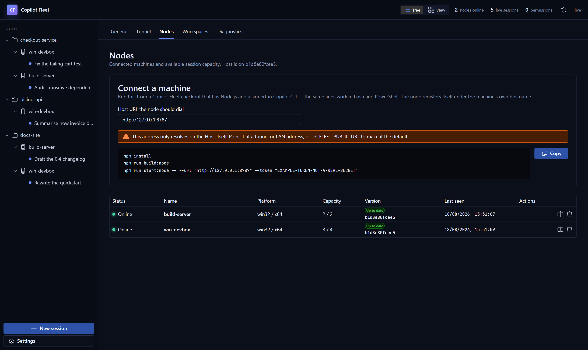
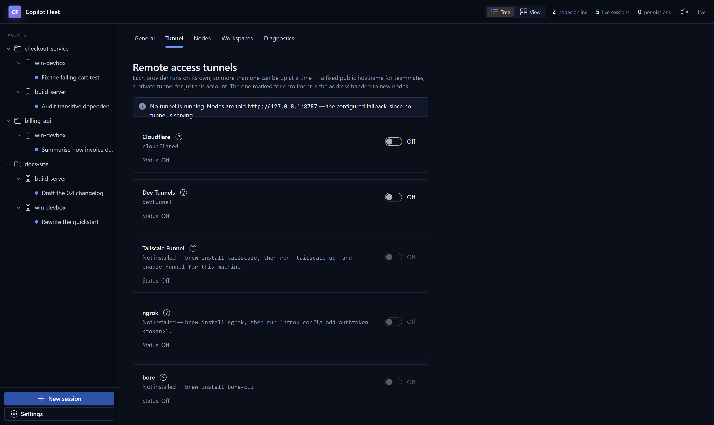

# Connecting and configuring Nodes

[← README](../../README.md) · [Guide index](README.md)

Enroll machines, start them at Windows sign-in, and manage each Node's local settings.

## Choose a connection for each Node

Enable one or more permitted providers under **Settings → Tunnel / Remote access**.
They run independently. Under **Nodes → Connect a machine**, each online provider
has a separate section and Generate button, with foreground and Windows login-start
commands. Generating a command for one provider does not change the Host default.
Each section generates its own one-use grant; copy one launch method for one worker.

Microsoft corporate Hosts can offer Corp direct and private Dev Tunnels together.
Other Hosts retain their existing permitted HTTPS providers, including concurrent
public-provider choices. Plain-HTTP providers remain refused.

Use **Corp direct (private IP)** for workers that can reach the private Host endpoint.
Cross-region private-IP connectivity is not guaranteed: region/pool routing and policy
must support the actual pair. Choose another enabled method, such as Dev Tunnels,
when that path is unavailable. Matching region or project names alone do not prove
reachability. See [Corp direct setup](../corp-direct.md).

The Nodes table's **Connection** column shows the last successfully authenticated
connection method. New Nodes report their transport; the Host recognizes ordinary
public routes by their actual dial origin and can infer some older routes from a known
ingress hostname. Older, unidentifiable connections show **Unknown** rather than a guess.
Update and reconnect Nodes for reliable reporting, especially for Dev Tunnels.
**Last known** marks an offline Node's previous route. This telemetry is runtime-only;
a Host restart or identity restore clears it until a Node reconnects. It is diagnostic
information, not an authorization rule or proof of network reachability.

## Windows login startup

Start automatically **after signing into Windows**, using your current account
and existing GitHub/Copilot credentials, plus Dev Tunnels sign-in only when using
that provider. In the chosen provider's **Nodes > Connect a machine** section,
copy the **npm run service -- node** command block to use a
command that builds, enrolls, and starts the Node without a foreground
connect/Ctrl+C step. The **npm run start:node** block keeps the existing direct
launch; Corp direct's foreground block uses **npm run node**. Both launch methods
are shown together within each section, each with its own Copy button.

```powershell
npm run service -- node --devtunnel="<tunnel-id>" --host-id="<host-id>" --host-fingerprint="<sha256>" --enrollment-grant="<id.secret>"
```

Use `--url="<host-url>"` instead of `--devtunnel` for a direct endpoint. The
service command accepts the same connection and settings flags as `start:node`;
enrollment grants/tokens are used only during setup and are never saved in the
scheduled task. The normal Node identity and settings are saved for later starts.
For an already enrolled Node, stop manual instances first and choose one:

```powershell
npm run service -- node install --existing-node
npm run service -- host+node install --existing-node
```

Installation builds, registers same-user scheduled tasks, and starts them now.
Use `status`, `logs`, `stop`, `start`, `restart`, or `uninstall` instead of
`install`. Stop disables automatic starts until `start`; uninstall preserves
your data. No Windows password or separate service credential file is required.
This does not run before Windows sign-in.

Interactive Node installation, start, and restart check GitHub CLI authentication
before proceeding. Missing or expired credentials open `gh auth login` in the
same terminal; after sign-in is verified, the original command continues.
Automatic logon starts never prompt. Copilot and Dev Tunnels retain their
separate sign-ins.

See [Windows login startup](../windows-login-startup.md) for options, lifecycle
details, credential caveats, and all historical design references.

## Linux login startup

On Linux the same `npm run service -- ...` commands install a **`systemd --user`**
unit per workload (`copilot-fleet-host.service`, `copilot-fleet-node.service`)
instead of a scheduled task. It runs as your normal account, starts at login,
and also at boot once lingering is enabled
(`sudo loginctl enable-linger "$USER"`). Root is refused.

```bash
npm run service -- node install --existing-node
npm run service -- host+node status
```

It needs a running systemd user manager. Plain WSL and containers usually have
none: enable `systemd=true` in `/etc/wsl.conf`, or run `npm start` under the
launcher, which also updates and restarts the Host and Node. See
[Linux login startup](../linux-login-startup.md) for details.

## Windows Node (PowerShell)

Install Node.js, then run `copilot update` and `copilot login` as the same OS
user that will run the Node. Copilot CLI 1.0.69 is the minimum because older ACP
builds can report authentication success while signed out, leaving a Host
session waiting with no failure to display. From a checked-out Fleet directory
(or paste the command from the Host's Nodes → Connect card):



```powershell
npm install
npm run build:node
npm run start:node -- --url="https://fleet.example.com" `
  --host-id="<host-id>" `
  --host-fingerprint="<sha256>" `
  --enrollment-grant="<id>.<secret>"
```

GitHub CLI (`gh`) must also be on PATH. `npm run start:node` and `npm run node`
check its active account before connecting or enrolling. In an interactive
terminal, missing/expired GitHub credentials trigger browser/device sign-in
in that same command, followed by verification and continued startup.
Cancellation stops startup without retrying login. Noninteractive launches
report the required login instead of waiting for input; network and executable
errors do not trigger re-authentication. If an environment token such as
`GH_TOKEN` is invalid, replace or unset it first: it overrides saved login.

The same lines work in bash — flags avoid the `$env:` / `VAR=value` split
between shells. Generate them from **Settings → Nodes → Generate a connect
command**. A signed-in Microsoft administrator can generate or replace a command
without signing in again. The grant is minted on request, is good for one machine
and fifteen minutes, and is never stored by the Host in a form it could hand out
again.

The node generates its own Ed25519 key pair _before_ it contacts anything, and
pins `--host-fingerprint`. A relay or an impostor that answers the URL cannot
produce a signature for the matching key, so the node sends it no enrollment
completion and accepts no command from it — which is what makes a relay merely
a relay.

The node name defaults to the machine hostname, and can be changed from either
end — the Host's Nodes tab or the node's own config page. Renaming keeps the
machine's identity, so its placements and sessions come with it; the Host owns
the name, so if both ends changed while the node was offline, the Host's name
wins and is pushed back down. Agents already running there can read the new
name without a restart — see [Node config page](#node-config-page). Pass
`--max-sessions 4` if you want a capacity other than 10.

Enrollment stores the node's private key and the Host's public key at
`$env:APPDATA\CopilotFleet\node.json`; subsequent starts need no grant, and no
reusable shared secret is ever issued. The service uses an outbound WSS
connection, so no inbound Node port is required.

The older fleet-wide `--token` / `ENROLLMENT_TOKEN` exists only for machines that
predate Node keys. A fresh Host has none: it neither requires one to start nor
persists one, and it refuses token registration outright. It is a reusable
credential that authorises any machine and that a node sends before it can tell
the Host from a relay, so it is deprecated. Existing nodes do **not** upgrade
themselves: a shared secret has already reached whatever relays that node's
connection, so nothing sent back over it can prove which Host is answering.
Migrate each machine by minting a fresh Connect command and running it there —
the grant is one-time, the fingerprint comes from your screen rather than the
wire, and enrolling under the machine's existing name reclaims the same node,
keeping its id, placements and session history. **Settings → Security** shows how
many are left and lets an administrator switch the shared secret off for good
once none are.

### Node command-line flags

Anything the node reads from the environment can be given as a flag instead, and
a flag wins over both `.env` and the saved `settings.json` — which is what makes
it usable to point one run at a different Host without editing files on that
machine. Run `npm run start:node -- --help` for the current list.

| Flag                              | Replaces                              |
| --------------------------------- | ------------------------------------- |
| `--url`, `--host-url`             | `FLEET_HOST_URL`                      |
| `--name`, `--node-name`           | `FLEET_NODE_NAME`                     |
| `--enrollment-grant`              | `FLEET_ENROLLMENT_GRANT`              |
| `--host-id`                       | `FLEET_HOST_ID`                       |
| `--host-fingerprint`              | `FLEET_HOST_FINGERPRINT`              |
| `--token`, `--enrollment-token`   | `FLEET_ENROLLMENT_TOKEN` (deprecated) |
| `--max-sessions`                  | `FLEET_MAX_SESSIONS`                  |
| `--copilot-command`               | `FLEET_COPILOT_COMMAND`               |
| `--permission-timeout-ms`         | `PERMISSION_TIMEOUT_MS`               |
| `--context-tier`                  | `FLEET_CONTEXT_TIER`                  |
| `--devtunnel`                     | `FLEET_DEVTUNNEL_ID`                  |
| `--config-port`                   | `FLEET_NODE_CONFIG_PORT`              |
| `--mock-agent`, `--no-mock-agent` | `FLEET_MOCK_AGENT`                    |

Both `--flag value` and `--flag=value` are accepted. The `--` after the npm
script name is npm's own separator; without it npm eats the flags. The same
flags work on `npm run node`, `npm run dev` and `npm start`, where they are
forwarded to the node process only:

```bash
npm start -- --url=https://fleet.example.com
```

Flags apply to that run; edits made later in the config page win until the
process restarts.

Note that `--url` takes effect by restarting the node, which ends the sessions
running on it — they settle as "Node reconnected without this session", and
anything that reached the agent can be picked up again with **Resume**. To
follow a rotated tunnel URL without losing live sessions, retarget from the node
config page instead: it reconnects in place.

The `nodeId` stored in `node.json` is the machine's identity. `--name` proposes a
new label for that identity; it does not create a second node or abandon the
existing node's placements and sessions.

## Node config page

Each node serves a small settings page starting at `http://127.0.0.1:8788`.
If that port is occupied, it tries up to 20 consecutive ports and prints the
actual URL. An exhausted range is reported explicitly; it never scans past 65535.
Set the preferred starting port with `--config-port` or `FLEET_NODE_CONFIG_PORT`.
Service enrollment/start also prints the collision notices and final config URL;
these are kept in the Node's runtime log. This is separate from the Host API's
port 8787, which is not automatically moved.

Use the config page to retarget the node when a tunnel
hands out a new URL — the node reconnects in place, so no restart is needed and
running sessions survive.

### Shared worker chat and offline continuation

When visiting a worker VM to inspect UI work, open this Node page's **Sessions**
tab and continue the same Host-dispatched conversation locally. Host and Node
share its chat and status while connected; eligible workers can keep chatting
locally during an outage and synchronize their new history afterward.
The [feature guide](../node-session-console.md) documents usage, offline limits,
safety invariants, code entry points and focused checks for contributors and
agents. Its [sequence diagrams](../node-session-streaming.html) show durable
live streaming and reconnect ordering; download/open the HTML in a browser
(GitHub displays its source).

**Sessions** opens Fleet conversations on this Node using the same chat components
as Host. Selecting a live conversation attaches a view to its existing worker;
it never starts a second Copilot process. Lists are paginated, transcript pages
and live subscriptions load only for the selected chat, and **Local Copilot
history** does not start discovery until expanded. A native conversation already
owned by Fleet offers **Open chat** instead of another resume.

On a compatible, mutually authenticated Host/Node connection, existing non-lead
workers receive a local-continuation grant at startup or their first reconnect
after upgrade. If Host becomes unreachable, open the Node console and continue
chatting with those running workers. Their prompts, output and queue operations
are journaled locally and reconciled to Host before queued Host work resumes.
The VM still needs access to the model provider; Host-backed tools and offline
lead prompts are unavailable. A Node restart preserves the journal, not a running
process: Host can reattach eligible sessions after synchronization without
re-executing completed or uncertain prompts.

**Permission approvals remain Host-only**, including when the Node is connected.
The local console shows permission requests and outcomes but cannot approve them
or enable a more permissive execution mode. A worker requiring new approval during
an outage waits or follows its existing timeout/cancellation behavior. Local
access intentionally also permits local programs to use chat: Origin/Fetch
Metadata checks prevent unwanted browser requests, not impersonation by a
shell-capable process. These controls are not an OS sandbox.

Local transcripts and attachment payloads are sensitive. They live in the private
`session-history` subdirectory of the Node's configuration directory, not in
worktrees or identity exports. Unacknowledged data is not silently evicted.
Moving the Node requires synchronization with the original Host first; service
uninstall continues to preserve files. An explicit same-origin
`POST /api/fleet-sessions/purge` with
`{"confirmation":"Delete local session history","discardUnsynchronized":false}`
removes this Host's local journal only when workers are stopped and pending
history is acknowledged. Setting `discardUnsynchronized` to `true` explicitly
discards pending evidence; it is not a secure-erasure guarantee. Older history
from before local journaling is available from Host on demand, not preloaded for
every session.

The Node UI is included in `npm run build:node` and the Node development startup.
Self-updates validate its generated asset manifest and revision before clearing
update quarantine. An older Host or legacy shared-secret enrollment must be
updated/re-enrolled before session-console synchronization is enabled.

### Other Node settings and identity

It also edits the node name, session capacity, Copilot executable path, and
permission timeout. Values are stored in `settings.json` beside the credentials
and take precedence over the environment variables, so an edit here is not
undone by a stale `.env` on the next start. Command-line flags outrank both.

Agents use it to learn which node they are on. A Fleet name is a label, so it
need not match the machine's host name, and an operator can rename the node from
the Host while its agents run. Every agent a node starts therefore gets two
variables: `FLEET_NODE_ID`, the node id, which a rename never changes; and
`FLEET_NODE_IDENTITY_URL`, this page's `/api/identity`, which answers a GET with
the name as of that moment (absent if the page could not start):

```powershell
Invoke-RestMethod $env:FLEET_NODE_IDENTITY_URL
# nodeId      : 0f8e6c2a-5b1d-4c3e-9f7a-2d4b6e8a1c3f
# nodeName    : build-01
# machineName : DESKTOP-7Q2M4VX
# connected   : True
```

`nodeName` is the name the Host last confirmed. `connected` is false while the
Host is unreachable, when a rename made there has not arrived yet. A worker the
orchestrator dispatches is told the node it was placed on, by name and id, and
pointed at both variables when its node sets them.

The listener binds to loopback only and is deliberately not exposed: anything
that can repoint a node at a different Host can run commands on that machine.
Reach a remote node's page over SSH port forwarding rather than binding wider.

## Following the Host to a new URL



Each provider runs on its own, so more than one can be up at a time; the one
marked for enrollment is the address handed to new nodes.

That address is the Host, not a separate handshake channel. The tunnel forwards
to `http://127.0.0.1:8787` (or `PORT`): `/api`, `/ws/node`, `/ws/browser`, and
the built UI when one is there. In `npm run dev` the page you click is Vite on
`http://127.0.0.1:5173`; the tunnel does not point at that. Opening the public
URL still hits the Host, so `/api/health` answers and everything else still
asks for a Microsoft sign-in.

When the Host's public address changes — a tunnel comes up, rotates, or is
switched to another provider — it tells the nodes that are still connected. Each
one records the new address, keeps the old one as a fallback, and **does not drop
the connection it already has**: the running sessions on it are unaffected, and
the new address is what the next reconnect dials.

This closes the gap where a rotated tunnel URL left every node dialing an
address that had stopped existing, with no way back except editing
`settings.json` on each machine.

What it does and does not cover:

- A node reached over an address that outlives the change — a LAN address, a
  named tunnel — is told and follows along.
- A node reached _through_ the tunnel that just rotated cannot be told: that
  socket died with the tunnel. It keeps retrying its known addresses, so it
  recovers on its own if one of them still answers.
- A private Dev Tunnel is advertised for enrollment but never pushed as a public
  Host URL. Its nodes use `--devtunnel=<id>`, keep a local `devtunnel connect`
  forward alive, and dial the loopback port that client reports.
- Loopback is never announced. When no tunnel is up and no `FLEET_PUBLIC_URL` is
  set, the Host's idea of its own address is `http://127.0.0.1:8787`, which on
  another machine points at that machine. Nodes are left on the address they
  have instead.
- A node running an older agent is skipped rather than sent a message it would
  reject, so a mixed fleet keeps working.

If an announced address turns out to be unreachable from a particular machine,
that node dials it, fails, and rotates to the previous address on the next
attempt — so an announcement can never strand a machine. Whichever address
answers becomes the one it leads with. The node config page lists the fallbacks
under the Host URL field.
