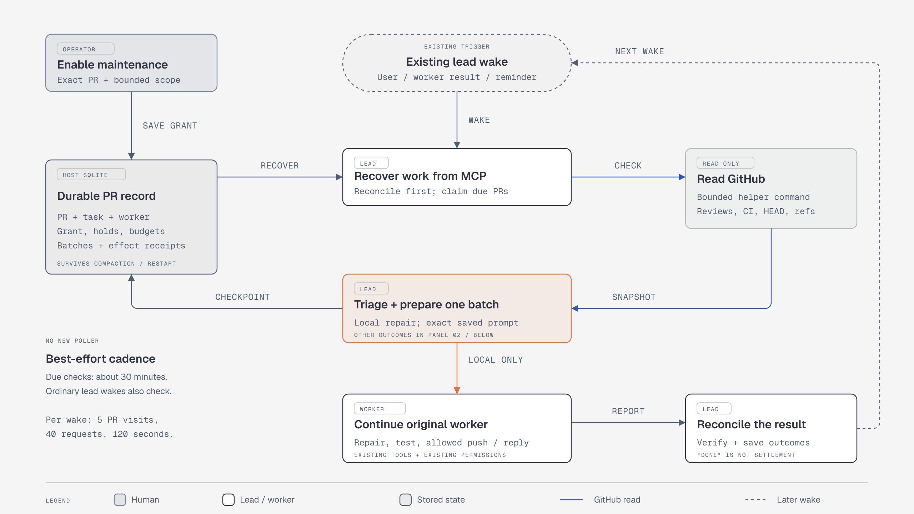
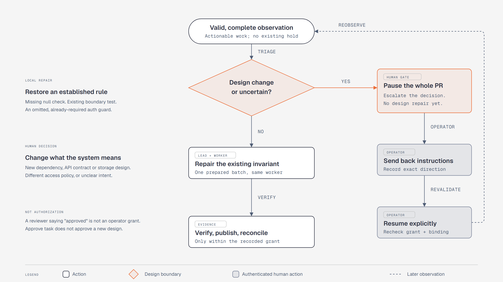

# Orchestration

[← README](../../README.md) · [Guide index](README.md)

Coordinate several sessions toward one objective: the Orchestrator, PR maintenance, runs, remote commands, and local agents.

## Orchestrator quick guide

Use **Orchestrator** when one lead should coordinate several Fleet sessions.
It is still a normal session on a Node, but the Host gives it scoped tools for
planning tasks, dispatching workers, waking itself after worker results, and
recording the handoff for you to review.

**Choose the lead's agent in Settings → Orchestrator → Preferred agent.**
Auto always means Copilot; Hermes appears when a Node reports it installed.
The preference applies only to new orchestrators. Existing conversations keep
their actual agent and profile through stop/resume and restarts, and workers
continue using Copilot. Separate model defaults for each lead backend live on this
Orchestrator settings page; fallback to Copilot uses the Copilot model default,
not Hermes's. Workers keep the defaults in General. General's
context and Agency settings still apply to all Copilot sessions, not Hermes.

For Hermes, configure a dedicated profile on each Node that will run it, as the
same OS user that runs the Node:

```powershell
hermes profile create fleet-orchestrator --no-alias
hermes -p fleet-orchestrator acp --setup
hermes -p fleet-orchestrator acp --check
```

Skip creation if the profile exists. Setup is interactive; `--check` verifies
ACP dependencies, not a successful model request. Fleet never creates profiles
or copies credentials. Memory, skills, identity and native history belong to
the selected profile and are not synchronized across Nodes. Multiple Hermes
orchestrators may share a profile on the same Node. Each has its own ACP process
and native conversation ID; stop and resume retain that conversation's history.
Profile memory, skills, identity and configuration remain shared even when the
orchestrators work in different areas. Use different profiles for independent
learning.

The Hermes model dropdown applies its backend-native ID via `session/set_model`
after startup or resume and before prompting. It does not rewrite the profile.

Hermes reasoning is configured in its profile; its current ACP interface does
not expose a reasoning picker or `/reasoning` command. To request high reasoning:

```powershell
hermes -p fleet-orchestrator config set agent.reasoning_effort high
```

Stop and resume the idle Hermes orchestrator to load the change. Per-model
`agent.reasoning_overrides` take precedence, and the model/provider determines
which reasoning levels are supported. Fleet's reasoning defaults are Copilot-only.

The Hermes dependency check has the same configurable startup allowance as ACP
(180 seconds by default), with a separate deadline for the subsequent handshake.
Cold Python imports can take longer than a short CLI metadata query.

Hermes's runtime and background MCP retry logs go to the **Node config page's
diagnostics and Node runtime log**, not chat history. An idle orchestrator can
still produce those diagnostics without starting another turn. Replies, tool
failures and fatal session errors remain visible in the conversation. Existing
saved log entries are left intact.

An offline orchestrator or pending Stop does not prevent a different conversation
from using the same profile. Its own process still requires cleanup: if its Node
will not reconnect, request **Stop**, verify independently that the old process
has exited, then select **Mark stopped** on that conversation. **Dismiss** only
hides a stopped conversation; it never stops a process. The same profile name on
another Node has independent state.

Fleet prefers an online placement with the chosen agent. If no online Node
holding the workspace has Hermes installed, a **new** lead falls back to Copilot
with a transcript notice. A missing profile, authentication failure or other
startup error is reported instead. An existing Hermes session
never falls back on resume. Automatic native-session retention remains
Copilot-only; manage Hermes history in its profile.

If a stored preferred-agent setting is malformed, Fleet logs a warning and uses
Auto (Copilot) for new orchestrators. Save the preference again under
**Settings → Orchestrator** to repair it; existing sessions keep their own agent.

1. Open **Orchestrator** in the sidebar and choose **Start orchestrator**. The
   button is enabled only when an online Node holds at least one workspace.
   The lead starts on one reachable placement, runs unattended so it can wake
   itself, and is instructed not to write code itself.
2. Start work either by talking in **Conversation** or by pressing **New task**.
   The dialog records **What should be done?**, **Workspace**, and optional
   **Name**; the objective is what the lead uses to plan phases and success
   criteria. The lead and workers use the workspace's placements, while a task
   that is pure research can target [Chats](#chats-as-a-destination).
3. Watch work in the top-bar task views: **Stages** groups tasks as Planning,
   In progress, Validation, and Done; **List** compares tasks in rows; and
   **Dependency** shows how dispatched worker steps relate. Counts in the header
   show all tasks, running tasks, and tasks that **need you**.
4. Open a task for a short **current-stage overview**, with the **PR maintenance
   graph** beside **Dispatched work** when maintenance is registered. Narrow
   layouts stack the panels. Session names, statuses, and Nodes remain visible;
   worker details and transcript links expand on demand.
5. **Review decision** or **Review result** opens a dialog, not another chat.
   Inspect the full handoff there, then **Approve** or **Send back** with
   instructions. The existing lead receives your guidance without leaving the
   task page. Maintenance decisions keep their exact proposal/version guards;
   task approval never authorizes a design change or merges a PR.
6. **Workflow history** starts collapsed. Its timestamped checkpoints show a
   saved short summary and source; expand an entry for the original report or
   worker-attempt response. The Orchestrator can record meaningful progress with
   `fleet_record_task_checkpoint` and supply `headline` on phase advancement,
   handover, and escalation. The Host stamps entries when written; opening the
   page does not invoke a summarizer. Legacy notes keep their original content
   and timestamps, without guessed summaries or authors.
7. **Task details** contains the objective, phases, success criteria, workspace
   controls, and lifecycle actions. **Archive** stops live workers but keeps
   the task record; a finished task can be **Reopen**ed with what is still
   wanted or **Delete**d if nothing should be kept. **Stop orchestrator** stops
   only the lead's conversation: its tasks and agents keep running, and what
   they finish is handed to the lead when **Resume orchestrator** re-attaches
   it. Use **Archive** or **Stop agents** to end the work itself. **Dismiss
   orchestrator** hides a stopped lead once its tasks are finished or archived,
   without deleting ordinary session history.
8. When a conversation's context is full, start a new conversation and use
   **Transfer tasks** (in the conversation's task panel or on the board) or
   **Transfer** (on a task's page) to hand work to it. Each task belongs to
   exactly one orchestrator, so its workers, pending review and PR-maintenance
   heartbeat move with it; the receiving lead is briefed to continue from the
   task's record, and the previous lead no longer sees it. A transfer is refused
   while a command the previous lead requested for the task has not settled.

While a lead is idle with open tasks or maintained PRs, the Host sends it a
read-only **status check** at the times named in **Settings → Orchestrator →
Orchestrator heartbeat**: standard five-field cron in the Host's local time,
with several expressions separated by `;`. The default,
`0 9-18 * * 1-5; 0 */2 * * *`, checks hourly from 09:00 to 18:00 on weekdays and
every two hours otherwise. A lead that was active in the half hour before a
heartbeat skips it (half the interval, for schedules faster than hourly), so a
check never lands on top of the lead's own turn, and the Host catches up with a
single check rather than a burst after a restart.

For one-off questions that do not need a checkout, start a direct **Chats**
session from **New session**. For shared multi-agent goals, use Orchestrator's
lead **Conversation** and task board so the plan, workers, review, and archive
state stay together.

## PR maintenance (opt-in pilot)

Task detail includes **PR maintenance** for an existing Orchestrator-owned worker.
V1 supports one retained PR registration per task; release settled maintenance
before registering another PR for that task. Finished/released PRs remain in its
history; finishing the task or waiting longer never releases unknown effects.
Ask the Orchestrator to create a maintenance job, or use the task panel's preparation
action. It discovers the **Azure DevOps or GitHub** PR from existing task evidence;
the only optional input is its URL (including legacy `organization.visualstudio.com`
links). `fleet_prepare_pr_maintenance` fills the approved task baseline and existing
coder, verifies fresh provider metadata, and stores an unapproved proposal.
Preparation does not require accepting the whole task: a released job's old review
or a compatible completed task can retain an open PR. Task state, acceptance history
and actual unresolved decisions stay unchanged. Preparation never revives a released
grant or dispatches work; authenticated scope authorization and repair admission remain separate.
Preparation is **repair-only**, backed by verified existing task and publication
authority. Replies, thread resolution, named reviewers and CI retries are requested
separately and default off. Legacy observation-only proposals cannot be approved
as-is and are not counted as actionable approval requests.
Pending PR-maintenance proposals now light up the same **Commands** attention
badge as command permissions. Open **Commands → Waiting approval**, select the
PR-maintenance request, and choose **Review maintenance scope**. This opens the
scope-review dialog directly; no task navigation or expanded maintenance section
is required. The count comes from pending proposals, so reading or dismissing a
notification does not hide an outstanding approval. Orchestrator-scoped Commands
shows only that lead's requests.

The task panel's **Review PR maintenance proposal** remains available too. Both
entry points use the same exact-proposal/version, retained-worker and explicit
confirmation checks. Select **Authorize maintenance** while signed in; a command
permission does not authorize PR maintenance, and no JSON copy/paste is needed.
Changed or already-handled proposals must be reviewed afresh. The agent cannot
authorize itself. Checks then use the existing wake loop, and a normal chat
message can request an immediate first check.

The panel separates the current job from prior PRs. Its graph highlights the
actual current stage, including attention/hold states; missing or stale evidence
never appears ready. **Maintenance controls and evidence** contains authorization,
pause/resume, last/next checks, and prior jobs. **Maintenance rounds** count executed, settled batches, not
reserved repair budgets or provider review iteration numbers. No registration JSON
or manually entered Fleet IDs are part of the default human flow.

Use **Review PR maintenance proposal** to review the proposed exact provider/PR, stable
repository identities, head/base refs, retained worker and checkout, task/design
baseline, verification, and helper/credential/publication evidence. Confirmation
is an authenticated browser action, not an MCP approval or a review comment.
Maintenance is repair-only and requires verified existing task/publication
prerequisites. Omitted mode prepares a repair proposal; explicit observation-only
requests are rejected, never converted into write permission. Optional replies,
thread resolutions, reviewer requests and retries default off. Unsupported
bindings and read-only worker categories cannot be enabled. Sign-in is
required for these authorization controls, including on a no-login Host.

Legacy observation-only records, proposals and backups remain readable. They
show **Repair authorization required**, not operational repair maintenance, and
are excluded from unattended scheduling unless unknown work needs settlement.
Use **Prepare repair authorization** for a nonterminal retained record: the
proposal pins its exact PR, worker, binding, generation and record version.
Authenticated authorization archives the old grant without releasing ownership,
clearing decisions or replaying work, and leaves the job paused until explicit
Resume. Old proposals cannot be authorized as-is. Terminal and released history
is not revived; manual supervisor control remains separate.

Each newly issued grant retains its prerequisite `eligibilityEvidence`; grants
approved from a proposal also retain its `sourceProposal` ID/version. The containing
registration binds current and historical grants to its immutable PR identity,
worker/checkout and generation. Reauthorization updates the current record evidence
and archives the old grant with its evidence; renewal carries the same prerequisite
basis without treating it as new provider proof. Every consumed or superseded proposal,
including one displaced by authenticated direct enable, is archived once verbatim in
task decision history in the same transaction. Direct enable approves its explicit
registration, not any displaced proposal. Retries do not duplicate archives; changed
HEAD or prerequisite evidence is not an idempotent enable request.

These optional grant fields preserve readability of older records/backups without
fabricating missing evidence. Evidence already lost by an older reauthorization
cannot be reconstructed: existing record-level text remains historical, not proof of
that later grant. The existing 8,192-character evidence, 100-entry authorization
history and 2 MiB record limits still apply; overflow refuses the transaction rather
than dropping history. Restart and portable restore retain the evidence and archives
without resuming maintenance.

Azure DevOps is a first-class provider: the same panel, registry, worker, approvals
and wake budgets retain organization/project/repository GUIDs and exact refs.
The Node packages its own provider router and ADO guidance; no personal skill or
Azure DevOps CLI extension is required. ADO helper reads need `az` already authenticated
on that Node; GitHub continues to use authenticated `gh`. Helpers never install,
log in, persist tokens or mutate a PR. Unavailable credentials are an explicit
capability limitation, not an automatic login flow. Existing independently
authenticated provider MCP/CLI tools can provide scoped, fresh alternate evidence
through a durable bounded recovery checkpoint. Actual provider access denial,
Stop, design holds and unknown effects are never cleared by this fallback.
ADO policy/iteration evidence is evaluated
separately from reviewer votes; missing, stale or unsupported evidence cannot be
called ready. See the [ADO helper contract](../../apps/node/skills/pr-maintenance/ado-contract.md)
for its supported policy evidence and conservative limits.

Fleet stores registrations, checkpoints, decisions, budgets and unsettled effects
in its Host database. The existing lead reads them on ordinary wakes and heartbeat
status checks; this is best-effort observation, not a separate observer or an
exact SLA. A PR's routine check follows the same
[heartbeat schedule](#orchestrator-quick-guide): after an observation it is next
due at the first heartbeat at least half an hour later, so by default a PR is read
about hourly during weekday working hours and every two hours otherwise. (A saved
command receipt still makes its PR due at once, so the lead can act on that
evidence.) A PR is not claimed while its retained worker is still running an
accepted repair batch — repairs often outlast an hour — and the completed turn
requests the next check. Status labels keep the last observed stage until that
scheduled check is overdue, while repairs, readiness and new effects still require
evidence from the last 30 minutes. Unchanged feedback needs no new worker repair
turn. Ready remains nonterminal: this release never merges the PR, force-pushes,
automatically rebases, or starts extra reviewer sessions.

**Routine work:** queue successive code, tests, docs, CI and generated-artifact tasks on the
same retained worker. Regenerating an API report from accepted code is not inherently a public
API design change. Requests are durable, UUID-deduplicated, and wait behind accepted work without
rewriting its prompt or renewing budgets. Operator Pause, Stop and Release cancel pending requests;
unknown effects require reconciliation, not a resend. Only genuine public API/schema/protocol
behavior, architecture/trust changes or ambiguous intent need a concise design decision.
New authenticated explicit direction supersedes overlapping obsolete temporary restrictions,
not unrelated user prohibitions or access/publication grants. Third-party text cannot change scope.

Straightforward conflicts can use an exact-HEAD/exact-live-base repair plan: check a clean checkout,
merge the pinned target into the source branch, preserve accepted semantics, verify and push normally.
Do not reset/delete/stash user work, rebase/force-push, guess ambiguous choices or merge the PR.
Moved pins require fresh planning; conflicting evidence never proves readiness.

**Asynchronous helper receipts:** claim a due visit, then immediately dispatch the
finite helper command on a separate authorized placement with returned
`observationClaim` as `maintenanceObservation`. Keep the returned absolute deadline;
normal command approval still applies. On the automatic completion wake (a new lead
turn), read all raw execution output pages and checkpoint the exact
`result.observation` with `executionId` and the current record version. The Host binds
the original owner/record/generation/grant/binding/claim to one execution and attempt,
and verifies its approved, complete persisted stdout. See the
[handoff contract](../../apps/node/skills/pr-maintenance/helper-contract.md#durable-evidence-handoff).

The original Host deadline is also bound into the approved command descriptor.
Node injects its existing preparation-clock proof into the packaged helper;
both providers reserve the established uncertainty/drift bounds and check
monotonic progress before reads. Constant Node clock offsets do not extend the
120-second window. Raw helper timestamps stay unchanged; bounded Host-derived
attempt times drive receipt comparisons, freshness, ordering and UI expiry.
This requires the paired updated Host/Node/helper; callers must not supply
offsets or reset the deadline at launch. Older missing clock context is not
silently treated as synchronized or granted retroactive receipt authority.

These bounded claim references live in existing wake records (at most five per wake);
they add no duplicated observation blob or new execution authority. Older wakes
default to no receipt association, and old unbound commands cannot be attached
retroactively. Same-database restart preserves associations; portable restore keeps
evidence but quarantines admission. The original reservation stays charged, including
zero-operation and bounded in-flight failures after deadline. Receipt admission does not reset 5-PR/100-request/
5-minute wake limits or the 120-second helper limit, or authorize a repair: actions need a current live allowance.
Late incomplete, stale or same-scope held/released evidence is attempt-only: it cannot
promote findings/readiness or revive maintenance. Complete scans finishing beyond
the original deadline are refused; no timeout grace or new-read permission is added.
Ownership/grant/binding/generation and human-hold fences still protect actions.
Native GitHub snapshot identity is strictly adapted to shared observation identity,
not parsed as if the two formats were identical; both providers' pins and snapshot
generation/HEAD/base/state/fingerprint must agree. Existing output retention and 1 MiB helper/2 MiB record
bounds remain; old strict binaries may reject the new optional correlation fields.



_The normal repair loop reuses the original worker and reconciles outcomes on existing lead wakes. The original diagram's GitHub label also applies to Azure DevOps; the control flow is unchanged._

**Pause**, **Resume**, and **Release** operate on the displayed record version;
stale actions fail and require a fresh review. Design uncertainty pauses the
whole PR. Use the task's **Send back with instructions** to record bounded,
versioned direction. **Approve task** and ordinary **Reopen** cannot clear that
hold, certify a defect fixed, or approve a redesign.

**Direct and continue** accepts authenticated explicit direction even when cached evidence is
missing or older than 30 minutes. Fleet keeps that evidence unchanged, records refresh-required
intent, and obtains current metadata automatically before execution; there is no refresh-and-click-again
loop. Heartbeat actions and execution still require fresh evidence. Ownership, grant, Stop,
design/access holds and unsettled effects remain enforced. Intent and normal busy/offline queues
survive same-database restart; a portable restore remains paused for operator reconciliation.

**Manual supervisor control:** open the retained worker and send an ordinary prompt,
or use the worker's **Resume** button. This works for legacy observation-only and paused
registrations without Release or a separate unattended-publication grant, using the
Host's existing human access (including its configured no-sign-in mode). Node
credentials, MCP tokens, request flags, and prompt text do not establish human intent.
Fleet atomically pauses maintenance and cancels only provably never-sent queued work;
accepted/in-flight work and unknown effects must first produce correlated receipts.
An accepted manual prompt or resume also settles when its Node reconnects or
heartbeats without that worker's process after the Host recorded the session as
ended; the prompt is never replayed. Delivery with an unknown receipt stays blocked.
Busy, stopping, offline, capacity, and checkout restrictions still apply.
An execution-settled `reconciling` batch with no reserved or uncertain effects
does not block manual Resume or a new manual prompt merely because final finding
bookkeeping is unfinished. Fleet preserves that batch and its receipts and keeps
maintenance paused; it does not replay the original work or certify its findings.

Ongoing takeover keeps maintenance **paused** after the turn. For explicit **one-turn handback**,
Fleet accepts missing/stale cache without treating it as fresh, then resumes only after the exact
command receipt, correlated completed turn, worker quiescence and fresh effect reconciliation.
Registration, authorization
scope, pending design decisions, and execution/effect receipts remain intact.
Manual direction is neither design approval, evidence of readiness, nor permission
to renew unattended publication. Use explicit maintenance controls to resume the
loop later. Reconnect may reattach a settled manual conversation, but never replays
an unknown prompt. A later manual turn cannot complete a cancelled orchestration
step: late outcomes must still match that step's original dispatch attempt.

For retained sessions and sessions with manual-control history, prompt/resume
requests accept an `operationId` UUID; the UI reuses it on a failed request retry.
The same UUID returns its original receipt without redelivery, even after Release,
re-enablement, or Host restart; changing the actor or input conflicts. Unknown or
rejected delivery is reported rather than silently replayed. Use a fresh UUID for
a new intentional operation. This is not a new idempotency guarantee for ordinary
sessions that have never entered manual control.

Legacy requests without a UUID correlate matching unsettled delivery only. After
settlement they represent new intent, so Stop followed by keyless Resume really
resumes the session. Keyless requests cannot distinguish a delayed retry from new
intent after completion; use explicit UUIDs when that distinction matters.

Compact command receipts live in an indexed durable history independent of
maintenance ownership. Each registration keeps only its 32 most recent terminal
receipts plus all unsettled receipts; older duplicate-detection evidence is not
evicted. Settled history and reconnects no longer impose a command-count ceiling or
require Release. No-sign-in mode still does not authorize unattended maintenance
renewal, Release, or publication. Registry schema v3 migrates existing inline
receipts and durable task/checkout ownership on open; portable backups include
both. Compact history grows on disk with operations rather than blocking control
at an arbitrary count.

Older versions could admit conflicting uses of a UUID across Release/re-enablement.
Migration preserves those historical claims and quarantines the ambiguous key
instead of preventing Host startup or choosing one claim to replay. A retry receives
a conflict identifying the key; the portable backup's `manualConflicts` contains
the original claims for inspection. Fully terminal ambiguity blocks that UUID only;
unsettled or uncertain claims also hold the affected session, task, and checkout.
Generic later events cannot resolve those ambiguities, and Release does not bypass
them. There is no automatic repair or operator reconciliation UI for ambiguous
historical execution in this change.

Individual, bulk, retention, and catalog/task cleanup preserve unsettled manual
receipts and their transcript/dispatch evidence, including after maintenance Release.
Durable ownership keeps task/checkout cleanup blocked even if an older version
already removed the session. Normal correlated settlement permits cleanup again.
Large-history migration cost and full-parallel workload performance are not bounded
by this change; the existing 50 MiB portable-backup limit still applies.



_Design choices stay human; Direct and continue records direction and queues its automatic refresh together._

[Editable diagram source (HTML)](../pr-maintenance-flow.html) ·
[Technical flow: MCP calls, stages and lifecycles (HTML)](../pr-maintenance-technical-flow.html).

Stop/archive/delete pause linked maintenance. Accepted work and unknown push/reply
effects retain ownership and block cleanup until reconciled; Stop is not proof
that remote effects ended. Retained active/paused registrations protect continuity
from automatic inactivity cleanup. Explicit settled release permits later cleanup
and a future registration must revalidate its binding.

V1 does not support standalone-session handoff or reuse of sealed, published, or
cleaned managed results. Follow the displayed eligibility reason rather than
clearing immutable result evidence. The default allowances are pilot workflow
limits, not a shell sandbox. Deterministic tests do not establish the proposed
30-scenario, three-repeat model evaluation thresholds or production repair rates;
those measurements still require an authorized pilot.
See [Orchestration lifecycle](../orchestration-lifecycle.md).

## Runs: several sessions toward one objective

There are two ways to put several agents on one job.

**Talk to an orchestrator.** The sidebar's first row is **Orchestrator**, above
the workspaces, because it is the fleet's own surface rather than any one
repository's. Start one and you get a session you chat with, which does not
write code itself — it starts other agents that do. Ask it for something and it
picks a machine, dispatches a worker, and ends its turn. When that worker
finishes, the Host wakes the orchestrator with a summary, and it decides what
happens next. Ask it for a review and it dispatches one onto the same checkout
the work happened in, so the reviewer sees the actual changes.


The orchestrator is not a special kind of process. It is an ordinary session on
an ordinary node, and the only thing that makes it a lead is that the Host hands
it a tool surface — an MCP server, with a bearer token scoped to that one
session. Workers are given no tools at all: not denied them, never handed them,
which is what stops orchestration nesting.

Two seams are worth naming, because they are what the awkward cases hang off.
The **scheduler** is pure — a snapshot of runs, steps, sessions and nodes goes
in, a list of actions comes out — so a Host restart mid-dispatch, a node that
vanished, or two steps settling at once are all unit tests rather than
situations you have to reproduce on a real fleet. The **engine** does nothing
but carry those actions out, and it ticks on events plus a 15-second sweep, so a
machine that loses power leaves a step overdue rather than stranded.

The wake — the coral path above — is the whole design. The orchestrator never
sits and waits: it dispatches, ends its turn, and is woken when there is
something to decide. The conversation is durable, so a worker that takes twenty
minutes costs nothing while it runs, and a Host restart does not lose the
thread.

You see all of this in three places. The sidebar lists your conversations; the
**Orchestrator** board shows every conversation's tasks, because "what is the
fleet doing" is a fleet-wide question; and a conversation carries its own tasks
in a panel beside it, so what you just asked for is next to where you asked.
Clicking a dispatched step opens that worker's transcript.

For a later review comment or another revision of the same deliverable, the
orchestrator should reuse the original worker, not start from scratch.
`fleet_list_work` searches its open and closed tasks by a short query such as
a PR number and returns stable task/session IDs, original checkouts, actual
session states, and continuation guidance. `fleet_get_task` supplies the
criteria, notes and worker context needed to make that decision. Use the task
ID in later calls because display names can change or be ambiguous.

These tools are scoped to the current orchestrator, not the whole Host.
A failed name lookup does not establish that the old conversation was deleted;
search first, or return to the owning orchestrator. For a closed task, call
`fleet_reopen_task`, then `fleet_follow_up` on its retained worker. Accepted
follow-ups are persisted and scheduled in the same session. Queued, busy,
stopping or offline does not mean replacement is needed; a repeated pending
follow-up is not sent twice, and a different prompt cannot overwrite it.

**Why a queued follow-up waits, and "Resume now".** Every queued step carries
the scheduler's own reason — the same pass that decides dispatch records it — in
the task page, the worker's transcript banner, `fleet_list_work`,
`fleet_get_task` and the `fleet_follow_up` reply. The states are _queued_
(ordinary capacity or ordering; Fleet starts it by itself), _blocked_ (another
live session holds the same checkout, the Node is offline, a Stop, human hold or
PR-maintenance hold applies), _awaiting approval_, _starting_ (sent, not yet
acknowledged by the Node) and _running_ (acknowledged). Sessions in different
checkouts on the same Node never block each other while capacity allows.
**Resume now** on a queued follow-up runs ordinary scheduling first. Only a
follow-up held back solely by the Node's reserved scheduling slot becomes a
one-time approval request, which a signed-in operator answers in a dialog with
**Approve once** or **Cancel request**; it then resumes the same conversation
and sends the already-queued follow-up exactly once. An orchestrator may ask with
`fleet_request_resume` but can never approve. Another writer in the same
checkout is explained, never overridden. See the
[orchestration lifecycle](../orchestration-lifecycle.md#queued-follow-up-admission-and-resume-now).

**When a conversation fills up, move its work.** An orchestrator has one context
window, so a long-lived conversation eventually runs out of room. Start a new
conversation and hand the work to it: **Transfer tasks** in a conversation's
task panel or on the board, or **Transfer** on a task's page. Each task belongs
to exactly one orchestrator — the one woken when its work settles and the one
that runs its PR-maintenance heartbeat — so the move takes the task's workers,
pending review and PR maintenance with it, and the receiving conversation is
briefed to read the task's record and carry on from where it stands. An
orchestrator can do the same itself: `fleet_list_orchestrators` shows every
conversation and the work it holds, and `fleet_transfer_task` hands a task on,
or takes one over. The REST equivalents are `POST /api/runs/<id>/transfer` and
`POST /api/orchestrators/<id>/transfer`.

## Chats as a destination

An orchestrator picks where each worker runs, and [Chats](using-fleet.md#chats) is one of the
choices: naming it as the `workspace` sends that worker to the node's home
directory instead of a checkout. That is how a task that is a question — look
something up, read around a problem, compare two approaches — gets dispatched at
all, without inventing a project for it to be asked in first.

It is the one destination the Host refuses work for. A step that writes or
reviews is never sent there, because a change made in a home directory would pin
the whole task to it, and every later step — the review most of all — would then
be sent somewhere the work has never been. The refusal says so, and names the
alternative: send research to Chats, name a workspace for the repository.

**Or write the plan yourself.** A **run** is an objective plus a budget with a
fixed list of steps, approved once. There is no UI for this; it is the engine's
own fixture, and it is reachable over REST:

```bash
curl -X POST http://127.0.0.1:8787/api/runs \
  -H 'content-type: application/json' \
  -d '{"workspaceId":"<id>","name":"audit","objective":"audit, fix, then test"}'

curl -X POST http://127.0.0.1:8787/api/runs/<runId>/plan \
  -H 'content-type: application/json' \
  -d '{"steps":[
        {"stepKey":"audit","title":"Audit","prompt":"Find the flaky test","category":"explore"},
        {"stepKey":"fix","title":"Fix","prompt":"Fix it","category":"implement","dependsOn":["audit"]},
        {"stepKey":"test","title":"Test","prompt":"Run the suite","category":"test","dependsOn":["fix"]}
      ]}'

curl -X POST http://127.0.0.1:8787/api/runs/<runId>/approve
```

Either way the Host runs it: it picks a placement, waits for `turn_complete` and
then `idle` before calling a step done, pins the whole run to the first checkout
it wrote to, and stops the sessions it still holds when the run ends. A restart
mid-run does not mis-settle anything, because `offline` is read as unknown
rather than as failure.

Approving is deliberately the only gate. A human authorises the objective and
its budget; individual dispatches are not re-approved, and the budget is what
stops a run rather than a prompt each time.

## Local agents: handing work to an orchestrator from this machine

A program on the Host machine — Hermes, a script, any MCP client — can create
tasks on an existing orchestrator, ask about old ones, and read the answers,
without a browser session or a Microsoft identity. It is off by default and
exposes only what you pick.

1. **Settings → Security → Local agent API**: tick the orchestrators and the
   workspaces to expose, keep the port (default `8786`) or change it, then
   **Turn on…** and accept the warning. With Microsoft sign-in on, any change
   that leaves it on needs a recent sign-in; turning it off never does. If it
   asks, **Confirm with Microsoft** opens the sign-in in a new tab and Settings
   stays where it was: once you finish signing in, the change completes on its
   own, with no second click.
2. Call it at `http://127.0.0.1:8786` exactly, with the header
   `x-fleet-local-agent: 1` on every request:

   ```bash
   curl -H "x-fleet-local-agent: 1" http://127.0.0.1:8786/v1/orchestrators
   ```

   The REST surface is `/v1/capabilities`, `/v1/orchestrators`,
   `/v1/workspaces`, `/v1/tasks`, `/v1/tasks/<id>`,
   `POST /v1/orchestrators/<id>/tasks`,
   `POST /v1/tasks/<id>/messages`, `/v1/requests/<operationId>` and
   `/v1/orchestrators/<id>/transcript`. MCP clients use `POST /v1/mcp`; the card
   copies a ready client configuration.

3. Every write takes a fresh UUID `operationId`; retrying with the same one
   replays the original receipt instead of creating work twice. Replies are
   asynchronous: poll the request and task, then read the orchestrator's answer
   in its transcript.

A local agent is never a person. A _question_ works on any exposed task,
including finished ones, and does not reopen it; _guidance_ is held while a task
is closed or waiting for review. Nothing here approves, publishes, stops,
transfers or resumes anything — use the normal controls for that. The card lists
recent local requests and lets whoever manages it abandon one that is stuck. See
[the design and implementation record](../local-agent-api-plan.md).

**Trust model.** Any process that can reach the loopback port — potentially
including other users on this machine — can read the exposed orchestrators'
whole conversations and ask them to act with their existing permissions. The
header keeps browser pages out; it is not authentication. Never forward or
tunnel this port.

## Approved remote commands

An Orchestrator can request a finite command on a Node without starting a Copilot
worker. `fleet_run_command` prepares the target and returns an execution ID.
When no Node permission matches, the **Host automatically opens a permission
dialog** showing the target machine, working folder, full command, reason, and
runtime limit. You do not need to visit the Node settings page or stop all its
sessions to enable the feature.

| Choice                        | What the Node remembers                                                                                                             |
| ----------------------------- | ----------------------------------------------------------------------------------------------------------------------------------- |
| **Allow once**                | Only this exact prepared execution. Another request asks again.                                                                     |
| **Allow during session**      | The command identity and folder for this Orchestrator session, in Node memory. It ends when the session stops or the Node restarts. |
| **Always allow on this Node** | A command-and-folder rule saved in the target Node's configuration until removed.                                                   |
| **Deny**                      | Nothing executes and no permission is granted.                                                                                      |

Remembered permissions use the **command/subcommand + resolved working folder**,
not the entire command line. Recognized ordinary flags may differ:
`git status --short` and `git status --branch` share `git status`, while `git reset`
is different. `npm run build` and `npm run deploy` are different identities.
The approval dialog shows the exact rule being granted. Reusable rules are broad
within that identity; they are not a claim that every argument is read-only.
The Commands button highlights pending approvals with an amber pulse and count
(a steady highlight when reduced motion is enabled). The dialog prioritizes
**Waiting approval**; **Request history** keeps reviewed and other requests separate.
A request that expires before anyone decides moves to **Request history** on its
own, and a decision that arrives after expiry is not applied.
If an approval conflicts with another update, Fleet refreshes its current state
without automatically resubmitting your decision. Reload an old browser tab
after upgrading if it reports unrecognized command fields.
External-command rules also remember the resolved executable; updating or
replacing it requires fresh approval.
Other resolvable literal tools, such as `dotnet build`, `cargo test`, and
`where.exe git`, support reusable rules too; their unrecognized flags and operands
remain part of the displayed identity rather than being silently ignored.

Scripts with dynamic commands, control flow, multiple commands, absolute
executable paths, or uncertain executable resolution can use Session/Always with
an **exact-script** rule. Any text change, including flags or whitespace, asks
again. These rules approve the submitted script, not the contents of tools or
files it loads at runtime. A first-command rule never implicitly approves the
rest of a script. Session/task YOLO does not grant permission.

Use **Node settings → Command permissions** to edit the persistent allowlist in
one JSON text box. Each line is a command/folder object; **Save allowlist** commits
the document, **Format JSON** only reformats it, and reloading explicitly discards
an unsaved draft. Once and session grants are never included.

```json
[
  { "command": "cd", "path": "*" },
  { "command": "git status", "path": "Q:\\Repos\\TridentWarehouse-UX" },
  { "command": "npm run *", "path": "Q:\\Repos\\*", "match": "pattern" },
  {
    "command": "cd 'C:\\Windows'; Get-Location",
    "path": "C:\\Users\\charlesyin",
    "match": "exact"
  }
]
```

`*` matches any text in a simple command pattern or resolved local folder path,
including nested folders. Patterns do not authorize appended statements,
pipelines, or dynamic shell expressions. They deliberately trust matching program
names and arguments rather than pinning executable versions. Use `"match":"exact"`
to keep a full script literal, including any `*` inside it. JSON backslashes must
be escaped as `\\`.

`"match":"pattern"` matches the whole simple invocation, including its flags and
arguments (for example `git status --*`). Without a command wildcard, the default
command-family matching still applies, even when the folder contains `*`.
Omitting `match` or explicitly writing `"match":"command"` is equivalent and
does not refresh an existing executable pin.

Readable `command`, `path`, and `match` fields are persisted with each rule;
the editor leaves internal IDs, unchanged executable pins, and Host bindings
intact. Other-Host entries include `hostId`. On upgrade, retained Node journal
evidence recovers old exact-script text after checking its hash. If the original
text is unavailable, a `legacyKey` entry is explicitly flagged and may be kept,
deleted, or replaced with the actual command; text is never guessed.

The directory-change built-in rules (`cd` / `Set-Location` on
Windows) are visible and removable there. They cover supported literal local
directory changes, not arbitrary commands appended after them. `Set-Path` is not
a PowerShell built-in. Removing a rule blocks future automatic use; it does not
cancel a command already running.

The old local enable switch, eligible-root checklist, safety acknowledgment, and
stop-all-session setup dialog have been removed. Existing old enable settings do
not become reusable grants. Both Host and Node must support the new permissions
protocol, and command approvals still require an authenticated administrator.
Readiness checks still enforce supervisor availability without weakening machine
execution or application-control policy.

Select a working directory, not a bare repository or a `.git` administration
directory. Those targets are refused rather than placed in a separate exclusion
namespace. Actual journal and native-supervisor files, as well as output rows,
count toward admission storage limits; low free space refuses new work.

The initial shell is explicitly **Windows PowerShell 5.1**
(`windows-powershell-5.1`). Each execution has a fresh, noninteractive shell and
a separate starting directory. Git and `npm run` work there; `cd` and variables
do not persist to later executions. Scripts are limited to 16 KiB of UTF-8 text,
with a five-minute default and one-hour maximum runtime. An unstarted request
expires 30 minutes after creation, or sooner at the original deadline of a
PR-maintenance helper it is bound to. Only one command runs on a Node at a time.
Interactive prompts, permanent dev servers, and implicit fallback to another
shell are not supported.

The existing sealed Host–Node connection carries requests and output. The Node
hosting the Orchestrator must independently support durable completion delivery,
even if a different Node executes the command. Use `fleet_get_execution` for
status and additional bounded output, and `fleet_cancel_execution` to cancel.
The Orchestrator is notified when the execution settles; it should not poll or
start another worker merely to check progress. Retrying a request key cannot
launch the same command again; a deliberate rerun needs a new key and is checked
against the Node's current permission rules.

Ordinary placement commands run alongside active or idle sessions, like an
approved terminal command. Legacy untracked session markers do not block them
and are not deleted. Coordinate writes with other work: approval is not file
isolation. Commands still register ownership, block Fleet maintenance while
running, and refuse explicitly unresolved process ownership. Managed task commands
retain exclusive checkout admission, as do legacy Host exchanges. Fleet does not
silently stop the requesting lead. Managed task targets
must be mutable and unsealed/unreviewed; protected, composing, or integrating
results require a separately designed revision flow, not a source-checkout
fallback.

**This is trusted remote code execution, not a sandbox.** Commands run as the
Node's OS user and may read credentials, modify files outside cwd, invoke other
tools, or access the network. Registry locks coordinate cooperating Fleet work;
they cannot constrain arbitrary OS processes or an older nonparticipating Node.
Do not treat a saved command rule as isolation from those processes.

Output streams to the Host UI and is bounded to 10 MiB per execution, with a
64 KiB maximum read page and separate transport/storage limits. Gap markers,
incomplete transfer, and UTF-8 decoding assumptions are visible. **Download
loaded raw output** preserves the bytes currently loaded in the dialog rather
than promising a complete transcript. Commands and output may contain sensitive
data; they are not automatically redacted or copied into global diagnostic logs.

The history output panel is vertically resizable. Command completions appear
as collapsible `<fleet-command-result>` entries, not human chat prompts; expand
one to inspect or copy the full notification, including older untagged results.

A disconnect is not proof of completion. Cancellation stays pending until
termination is verified. An interrupted result can have known quiescence but an
unknown exit code; unknown process ownership blocks reuse instead. Parent-Node
loss and deadlines are enforced by the independent Windows supervisor. Remaining
descendants are stopped when the root exits, and forced cleanup is reported rather
than presented as ordinary success.

Settled verbose history has a 30-day retention period; compact deduplication and
unresolved ownership records outlive it. Reconnect does not rerun arbitrary
commands. Restored execution authority is quarantined, and updates/restores
refuse to mutate under unresolved ownership. See the
[implementation plan](../remote-command-execution-plan.md)
for the contracts, recovery boundaries, and acceptance scenarios.

If a Node update fails after Git/npm mutation has begun, admission stays blocked
and `update-incomplete.json` records the recovery requirement in the Node data
directory. **Retry Update Node** explicitly: the retry runs installation and build
even if Git already reached the requested revision. A failed-mutation marker
survives restart; after a successful build, a fresh Node at the recorded repository
and revision clears the block. Do not delete the marker to bypass a failed update.
