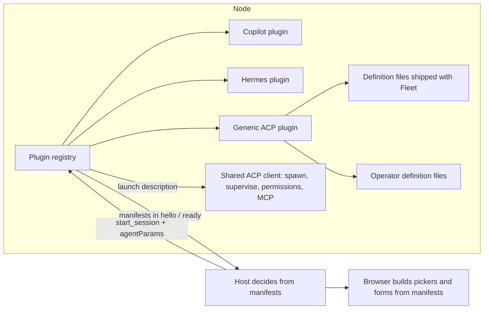

# Agent plugins: add agent kinds without changing Fleet's core

**Area**: Node agent launch, Host scheduling and settings, protocol  
**Engineer**: Not assigned  
**Driver / Approver**: Charles Yin, repository owner  
**Status**: Design approved in conversation; written spec under review; not implemented  
**Date**: 2026-10-26  
**Source baseline**: `daed730` on `main` (drafted at `3456c2a`; rechecked against `daed730`)  
**Work item**: Not supplied

## Related documents

| Document | Link |
| --- | --- |
| Current agent backends (Copilot + Hermes) | [orchestrator-agent-backend-plan.md](../../orchestrator-agent-backend-plan.md) |
| Earlier harness exploration | [2026-08-18-orchestrator-harness-choice.md](2026-08-18-orchestrator-harness-choice.md) |
| Earlier compile-time plugin plan (tunnels, not implemented) | [2026-08-20-tunnel-plugin-decoupling.md](../plans/2026-08-20-tunnel-plugin-decoupling.md) |
| Worker execution profiles | [2026-10-12-experimental-worker-model-routing.md](2026-10-12-experimental-worker-model-routing.md) |
| Task Node binding (designed in #104, not implemented) | [2026-10-26-task-node-binding-design.md](2026-10-26-task-node-binding-design.md) |
| Architecture | [ARCHITECTURE.md](../../../ARCHITECTURE.md) |
| ACP initialization and capabilities | [agentclientprotocol.com/protocol/initialization](https://agentclientprotocol.com/protocol/initialization) |
| ACP session config options | [agentclientprotocol.com/protocol/v1/session-config-options](https://agentclientprotocol.com/protocol/v1/session-config-options) |
| ACP agent list | [agentclientprotocol.com/get-started/agents](https://agentclientprotocol.com/get-started/agents) |
| Claude Code ACP adapter | [agentclientprotocol/claude-agent-acp](https://github.com/agentclientprotocol/claude-agent-acp) |
| Inspiration | [deepseek-ai/deepseek-harness](https://github.com/deepseek-ai/deepseek-harness) ("everything is a plugin") |

## Summary

Fleet runs Copilot for every session and Hermes for orchestrators. Adding a
third agent today means editing the protocol, the Host, the Node and the UI:
the merge that added Hermes (`b88e238`) touched 47 files, and the literal
`"hermes"` still appears in about 15 non-test files outside
`apps/node/src/agent-kinds/`.

This design turns agent kinds into plugins:

- Each Node describes the agent kinds it can run with **manifests**, small
  data-only records sent in its `hello`/`ready` inventory.
- The Host and browser make every decision from manifests and never branch on
  an agent kind's name.
- Agent kinds come from **built-in code plugins** (Copilot, Hermes) or from
  **definition files** run by one built-in generic ACP plugin. A
  definition file is enough for any agent that follows ACP well; Claude Code is
  the first.
- Plugin code may import only from a new `@fleet/plugin-api` package, so a later
  change can load plugins installed separately by operators without redesigning
  the contract.
- Workers can use another agent kind through **execution profiles**, which gain
  an optional agent field.

## Why

Charles maintains Fleet as a personal project. If more people use it, requests
such as "support Codex" or "support Claude Code" will arrive faster than one
person can implement them. With this design such a request becomes a
definition file that one person can review, or a plugin folder that a
contributor owns, and it does not change Fleet's core.

## Decisions

These were agreed in conversation before this document was written.

| ID | Decision |
| --- | --- |
| D1 | **Built-in first, installable later.** Plugins ship inside the repository at first. Contracts are versioned and designed as if third parties will use them, so a later change can load installed packages. |
| D2 | **First project is the plugin foundation plus agent kinds.** Fleet tool plugins, themes and other plugin types get their own specs later. |
| D3 | **Orchestrators first, then workers**, in one spec, with behavior gated by declared features. |
| D4 | **Workers choose an agent kind through execution profiles.** A profile becomes agent kind + model + effort. Copilot stays the default. |
| D5 | **Two sources of agent kinds:** a generic ACP plugin that reads definition files, and code plugins for agents with special needs. |
| D6 | **Claude Code is the acceptance agent**, through `@agentclientprotocol/claude-agent-acp`. |
| D7 | **Approach A:** Nodes describe agent kinds with manifests; the Host stays generic; plugin code runs only on the Node. |

### Approaches considered

| | A. Nodes describe agent kinds (chosen) | B. Shared plugin list compiled into Host, Node and browser | C. Open the agent list and add one generic kind |
| --- | --- | --- | --- |
| Where plugin code runs | Node only | Node, Host and browser | Node only |
| Adding an agent from a definition file | No Fleet change | No Fleet change, but through a second path | No Fleet change |
| Adding a code plugin | Node release only | Host and Node release | Core edits across about 15 files |
| Mixed-version fleets | Safe; the Host reads what each Node declares | Host and Node must share a plugin list | Safe |
| Path to installable plugins | Replace the Node's loader | Needs loaders on three sides | None |

A matches the rule "Node owns execution" from ARCHITECTURE.md and keeps one
plugin API to stabilize instead of three.

## Terms

- **Agent kind**: which agent program a session runs (Copilot, Hermes, Claude
  Code). The code already uses `AgentKind`; this design keeps the name.
- **Manifest**: data a Node sends about one agent kind: identity, roles,
  parameters and features.
- **Code plugin**: a TypeScript module under `apps/node/src/plugins/<id>/` that
  implements an agent kind.
- **Definition file**: a JSON file describing an agent kind that speaks standard
  ACP, run by the generic ACP plugin.
- **Role**: a session's `runRole`: `""` (a plain session), `lead`
  (orchestrator), `worker` or `reviewer`.

## Architecture



1. When a Node starts and on each reconnect, its plugin registry runs every
   plugin's `detect()` and collects one manifest per available agent kind.
2. The Node sends the manifests in its inventory. The Host stores them per Node.
3. To start or resume a session, the Host sends `agentParams`. The Node finds
   the plugin, validates the parameters against the plugin's declared schema,
   and asks the plugin for a launch description.
4. The shared ACP client starts and supervises the process exactly as today.

**The core keeps ownership of:** process spawning, Windows Job Object
supervision and verified process-tree termination, permission answers, MCP
injection (including the per-session Fleet bearer), event sequencing, journaling
and replay suppression. Plugins never spawn processes, so every agent kind gets
the same lifecycle guarantees.

**The Host and browser decide from manifests, not from names.** An agent kind's
name may appear in Host or UI code only where the code is about that agent's
own data or history, never to decide what a session may do. The allowed places
are:

1. The compatibility module that writes manifests for Nodes without
   `agent-plugins-v1` (see [Mixed versions](#mixed-versions)).
2. The rule that **Auto** means Copilot.
3. Cleanup and migration of existing usage records: the legacy Hermes
   usage source in `apps/host/src/usage-store.ts` and the Copilot credit
   backfill in `apps/host/src/usage-backfill.ts`.
4. Wording that explains a specific agent's own reporting, such as Copilot's
   input budget and `/context` text in `SessionUsageBar.tsx`. Phase 1 moves
   that wording behind manifest fields (`usage.*`) where a field exists, and
   keeps the rest in one labelled table.

The name check test reads an explicit list of allowed files from the test
itself. Any other Host or UI source file that contains an agent kind's name as
a string literal fails the build. Adding a file to the list is a reviewed
change.

## Contracts

### Manifest

Defined in `@fleet/plugin-api` and re-exported by `@fleet/protocol`. Zod
validates it; each manifest is limited to 8 KiB serialized and a Node sends at
most 32.

```ts
type AgentManifest = {
  apiVersion: 1;
  id: string;                    // ^[a-z][a-z0-9-]{1,39}$
  label: string;                 // display name, max 60 chars
  version?: string;              // detected program version, max 100 chars
  source: "builtin" | "definition";  // "installed" is reserved for later
  roles: Array<"" | "lead" | "worker" | "reviewer">;
  params: ParamSpec[];           // max 8
  features: {
    resume: boolean;             // session/load works
    httpMcp: boolean;            // can receive an HTTP MCP server
    unattended: "launch-flag" | "auto-approve" | "none";
    nativeHistoryCleanup: boolean;
    nativeStateFiles: boolean;   // the plugin can name the native session folder downloads may read
    nativeLogSync: boolean;      // the plugin can import turns taken outside Fleet from the agent's own log
    adoptExisting: boolean;      // can attach to an existing native conversation
    images: boolean;             // accepts image prompt blocks
    usage: { context: boolean; tokens: boolean; credits: boolean };
    rollover: boolean;           // automatic recovery when the context window fills
    verified: boolean;           // features were measured from ACP initialize
  };
  launchOptions: string[];       // Host-supplied options this kind accepts, e.g. "agency", "contextTier", "customAgent"
  setupHint?: string;            // max 300 chars
};

type ParamSpec = {
  key: string;                   // ^[a-z][a-zA-Z0-9]{0,31}$
  label: string;
  type: "string";
  pattern: string;               // a regular expression anchored with ^ and $; both Host and Node apply it
  maxLength: number;             // <= 128
  required: boolean;
  default?: string;
};
```

`copilot` and `hermes` are reserved IDs. A definition file may not use them.

### Agent parameters

`AgentParamsSchema` becomes generic:

```ts
type AgentParams = { kind: string; params?: Record<string, string> };
```

- Legacy rows `{ kind: "hermes", profile }` parse and are normalized to
  `{ kind: "hermes", params: { profile } }` on read. A missing `agentParams` still
  means Copilot.
- The Host validates `params` against the target Node's manifest for usability.
  The Node validates again against the plugin's own schema and is authoritative.
- A plugin never receives an undeclared key. Values become whole argv elements
  or environment values; they are never joined into a command line.

### Code plugin API

```ts
export default definePlugin({
  apiVersion: 1,
  id: "hermes",
  async detect(ctx): Promise<AgentManifest | undefined> { ... },
  create(params, ctx): AgentKindAdapter { ... },
});
```

`ctx` provides only: a scoped logger, the Node ID, a per-plugin configuration
directory under the Node config directory, `findCommand(name)` (PATH search,
from today's `findAgentCommand`), `runBounded(command, args, timeoutMs)` (from
today's `agentOutput`) and ACP helper types. It does not expose the store, the
router, the Host connection or the process supervisor.

`AgentKindAdapter` keeps the shape of today's `apps/node/src/agent-kinds/types.ts`
with these changes:

- `prepare()` returns a launch description: `command`, `args`, `env` additions,
  optional `notice`, and `failureMessage`. The core spawns.
- New optional `startupConfig(role)` returns initial session settings. Copilot
  returns today's `mode: agent` for leads and workers, which removes the
  Copilot-only branch from the Host's `startupConfigFor`.
- New optional `deleteHistory(nativeSessionId)`, present only when the manifest
  declares `nativeHistoryCleanup`. Copilot moves today's retention deletion here.
- New optional `nativeStateDirectory(nativeSessionId)`, present only when the
  manifest declares `nativeStateFiles`. Copilot moves today's
  `<COPILOT_HOME>/session-state/<id>` rule from `apps/node/src/session-files.ts`
  here, so session downloads stop special-casing Copilot.
- New optional `followNativeLog(nativeSessionId)`, present only when the
  manifest declares `nativeLogSync`. Copilot moves today's
  `NativeSessionFollower` (`apps/node/src/native-session-sync.ts`) behind it.
  The core starts following a session only when its plugin provides the hook,
  so a non-Copilot session is never matched against Copilot's
  `session-state` folder.
- `usage`, `configOptions`, `setConfigOption`, `stderrLogLevel`, `rollover` and
  `tracksUnpromptedWork` remain optional hooks.

### Definition files

Read by the generic ACP plugin from two directories:

1. Shipped: `apps/node/agent-definitions/*.json` (in the package, outside `src/`).
2. Operator: `<Node config directory>/agent-definitions/*.json`.

An operator file with the same `id` replaces the shipped one, the same rule
`apps/node/src/agent-catalog.ts` uses for custom agents.

```json
{
  "apiVersion": 1,
  "id": "claude",
  "label": "Claude Code",
  "command": "claude-agent-acp",
  "args": [],
  "detect": { "versionArgs": ["--version"] },
  "roles": ["lead", "worker", "reviewer"],
  "params": [],
  "env": {},
  "unattended": { "approve": "allow_always" },
  "startupConfig": { "unattended": [] },
  "setupHint": "npm install -g @agentclientprotocol/claude-agent-acp, then sign in to Claude Code once as the user that runs the Node."
}
```

Rules:

- `command` is a program name found on PATH, or an absolute path to an
  executable. No shell expressions.
- An `args` element is either literal text or exactly `{params.<key>}`, which
  is replaced by one declared parameter value as a whole argument.
- `env` is a map of names (`^[A-Z_][A-Z0-9_]{0,63}$`) to literal strings or
  `{params.<key>}`. Names used by Fleet itself (`FLEET_*`) and loader or library
  paths (`PATH`, `NODE_OPTIONS`, `LD_PRELOAD`, `DYLD_*`) are rejected.
- `startupConfig.unattended` lists `{ id, value }` ACP session settings applied
  when a session runs without permission prompts (YOLO). Each is applied only
  if the agent offers that option and value; otherwise the generic plugin
  answers permission requests with `allow_always`, then `allow_once`, as Hermes
  does today.
- **Features are measured, not declared.** On Node start and on each reconnect,
  before the inventory is sent, the generic plugin checks any definition whose
  `(id, version)` has no cached result: it starts the agent, sends ACP
  `initialize`, records `loadSession`, `mcpCapabilities.http` and
  `promptCapabilities.image`, and closes it within the startup allowance. The
  result is cached per `(id, version)` under the plugin's config directory and
  reported with `verified: true`. An agent kind whose check fails or times out
  is left out of the manifests, and its error is listed on the Node config page.
  The inventory is sent only at connection time today, so a newly added or
  upgraded definition file reaches the Host on the Node's next reconnect;
  restarting the Node applies it at once.
- Generic agents report context usage from ACP `usage_update` notifications.
  Token and credit totals stay unknown (`?`) unless a code plugin reads the
  agent's own records. `nativeHistoryCleanup`, `nativeStateFiles`,
  `nativeLogSync`, `adoptExisting` and `rollover` are false.
- An invalid file is logged and listed with its exact validation error on the
  Node config page and in Settings → Agents. It never stops the Node from
  starting.

## What moves where

| Today | After |
| --- | --- |
| `apps/node/src/agent-kinds/copilot*.ts`, Agency launch (`copilot-launch.ts`), credits and `/context` reader, native-session deletion in `copilot-sessions.ts` and the router | `apps/node/src/plugins/copilot/` |
| Native session log sync (`native-session-sync.ts`, merged in #105), wired in `main.ts` for every session; its router hooks (`beforeResume`, `nativeSession`, `launchingNative`, `turnEnded`) | Copilot plugin's `followNativeLog` hook. The router keeps the generic hook points and calls them only for sessions whose manifest declares `nativeLogSync` |
| `apps/node/src/agent-kinds/hermes*.ts`, Hermes checks in `router.ts` (delete refusal, profile change refusal), Hermes branch in `usage-totals.ts` | `apps/node/src/plugins/hermes/`; `profile` becomes a declared parameter |
| `createAgentKind` switch, `detectAgentKinds` in `agent-kinds/index.ts` | `apps/node/src/plugins/registry.ts` |
| Generic helpers (`findAgentCommand`, `agentOutput`, `copilotSpawnTarget`) | `@fleet/plugin-api` (search and probe) and the core (spawn target) |
| Host `fleet-service.ts`: workers limited to Copilot, Copilot-only adopt, Agency and context tier, custom agent, startup config | Manifest checks: `roles`, `adoptExisting`, `launchOptions`, plugin `startupConfig` |
| Host `session-retention.ts` Hermes exclusion; `session-files.ts` Copilot-only native state access | `features.nativeHistoryCleanup`; `features.nativeStateFiles` with the plugin's `nativeStateDirectory` hook on the Node |
| UI `OrchestratorPanel.tsx` Hermes branches; labels in `SessionInfoDialog`, `SessionTile`, `TerminalView`, usage views | Generic picker and parameter form from manifests; `manifest.label` |
| `AgentKindSchema = z.enum(["copilot","hermes"])`, `agentKindLabels` | Open string ID plus manifests; labels from manifests |

Behavior that is about Copilot itself stays in the Copilot plugin and is reached
through existing optional hooks: the minimum version check, held-prompt and
unprompted-turn detection from Copilot's session log, and context rollover.
Router state that is generic today, such as capacity reservation and the rule
that a live session cannot change its agent kind or parameters, stays in the
core and compares the whole `agentParams` value instead of naming Hermes.

## Host and UI

### Host

- **Storage.** A new `nodes.agent_manifests` JSON column replaces
  `nodes.agent_kinds`. `FleetNode.agentKinds` is still derived from the
  manifests, for older clients.
- **Starting a session** is refused when:
  - the target Node does not offer the agent kind;
  - the manifest does not allow the session's role;
  - the session needs Fleet's MCP server and `features.httpMcp` is false
    (orchestrators, and workers granted Host MCP forwarding);
  - the session runs without permission prompts and `features.unattended`
    is `"none"`;
  - `params` fail the manifest's rules.
- **Resume, automatic reconnect, retention, file downloads, Agency, context tier
  and custom agents** check manifest fields instead of names. A saved session
  always resumes on its stored agent kind and parameters. A missing agent kind
  blocks resume with the manifest's `setupHint`.
- **Orchestrator preference.** `orchestratorAgent` stores `AgentParams` in the
  new shape. The orchestrator route (`apps/host/src/routes/orchestrators.ts`)
  replaces `supportsAgentKind(node, kind)` with a manifest lookup. A new
  orchestrator falls back to Copilot, with the existing transcript notice, only
  when no online placement offers the preferred agent kind for the `lead` role.
  Lack of capacity is a refusal, as today, and a startup or sign-in error is
  reported, not hidden by a fallback.
- **Model defaults.** `orchestratorModels` becomes a map keyed by agent kind
  ID instead of the closed enum. Existing keys migrate unchanged.

### Choosing a worker's agent (phase 3)

- `WorkerExecutionProfileSchema` gains optional `agent: AgentParams`, and its
  `model` becomes optional (omitted means the agent kind's own default). A
  profile without `agent` means Copilot, so existing profiles are unchanged.
- **Behavior change:** when worker routing is Off, an explicit `profile` on
  `fleet_start_work` whose profile has an `agent` still applies as an explicit
  choice. No automatic decision runs and no provider is called. Profiles
  without `agent` keep today's Off behavior (ignored).
- `decidePlacement` filters candidate Nodes to those whose manifest offers the
  profile's agent kind for the step's role (`worker` or `reviewer`). If none
  qualifies, the dispatch is refused with the reason, the same way an unknown
  profile is refused today. A Copilot worker is never substituted.
- If task Node binding (designed in #104) is implemented first, a task's
  workers can run only on its bound Node. The agent-kind check then applies to
  that one Node, and a refusal names both facts: the task's bound Node, and
  that the Node does not offer the profile's agent kind.
- The profile's model list in Settings reads the model catalog reported by that
  agent kind.
- A worker keeps its stored agent kind and parameters for follow-ups and
  resumes. Editing a profile never changes a live worker.
- `fleet_get_worker_routing_policy` lists each profile's agent kind, so an
  orchestrator can choose, for example, to send reviews to Claude Code.

### UI

- **Settings → Agents** (new): each agent kind with the Nodes that offer it and
  their versions, its source, roles, verified features and setup hint, plus
  definition-file errors reported by Nodes.
- **Settings → Orchestrator → Preferred agent**: a generic picker over agent
  kinds offering the `lead` role, plus a form generated from the manifest's
  `params`. Replaces the Hermes profile field. A saved preference stays visible
  when no Node offers it, as today.
- **Worker model routing → profiles**: an Agent field (Copilot by default).
- **Session header, information dialog and usage**: show `manifest.label`.
  Unreported figures stay `?`.
- **Node config page**: detected agent kinds and definition-file errors.

## Mixed versions

- Nodes with this change advertise the capability `agent-plugins-v1` and send
  `agentManifests` in the inventory, alongside the existing `agentKinds`.
- For a Node without `agent-plugins-v1`, the Host compatibility module writes
  manifests: Copilot always, and Hermes when the Node reported it. Such Nodes
  behave exactly as today.
- An older Host does not know `agentManifests` and ignores it, because the
  inventory schema is a non-strict `z.object`. It keeps reading `agentKinds`.
- A Host never sends a non-Copilot, non-Hermes `agentParams` to a Node without
  `agent-plugins-v1`.
- Host backups carry the new `agentParams` shape and profile `agent` fields.
  Restoring an older backup normalizes legacy Hermes rows.

## Security

- **Definition files carry worker authority.** A file names a program, and that
  program gets full worker authority on the Node: YOLO, the session checkout
  and, for orchestrators, a Fleet MCP token. Only someone with access to the
  Node's config directory can add one. The Host cannot push definition files
  to Nodes, and agents cannot create them through Fleet.
- **Plugin authority is bounded.** A plugin can choose a command, arguments and
  environment, answer ACP setting changes and read its own usage files. It
  cannot widen permissions, reach the Host, disable process supervision or see
  another session's MCP token.
- **No command injection.** Parameter values pass the declared patterns on the
  Host and again on the Node, become whole argv elements, and never pass
  through shell joining. Windows `.cmd` launchers continue to use the existing
  quoted spawn path with arguments passed separately; a test covers
  metacharacters in parameter values.
- **Fleet records every unattended approval.** A generic agent's YOLO
  permissions are granted by Fleet's own permission handler
  (`requestPermission` in `apps/node/src/agents.ts`, which today auto-approves
  for Hermes). Phase 2 adds a transcript entry for each automatic approval,
  naming the tool call and the option chosen, because today those approvals
  leave no record.
- **Hard limits stay on the Host:** run budgets, `maxSessions`, read-only
  categories, checkout locks and maintenance holds. No agent kind can change
  them.
- **Read-only is still a label.** A plugin agent's reviewer is no more
  sandboxed than a Copilot reviewer; read-only remains a capacity label, not a
  filesystem guarantee.
- **The Node checks code plugins at build time.** `apps/node/src/plugins/**`
  may import only `@fleet/plugin-api` (and Node built-ins), enforced by an ESLint
  `no-restricted-imports` rule.

## Phases

Each phase is a separate PR. Phase 1 changes no visible behavior.

1. **Foundation.** `packages/plugin-api`; plugin registry; manifests in the
   inventory and `agent-plugins-v1`; the Host compatibility module and
   `agent_manifests` column; Copilot and Hermes moved into plugin folders; Host
   and UI name checks replaced with manifest checks; the lint rule and the name
   check test.
2. **Generic ACP plugin and Claude Code as orchestrator.** Definition-file
   loading, feature measurement and caching, `claude.json`, Settings → Agents
   and the generic preferred-agent picker.
3. **Workers through profiles.** Profile `agent` field, placement filtering,
   explicit choice with routing Off, Settings profile editor, briefing and
   policy tool output.
4. **Documentation.** `docs/guide/agent-plugins.md` (writing a definition file
   and a code plugin), ARCHITECTURE.md, and a note at the top of
   `docs/orchestrator-agent-backend-plan.md` pointing to this design where they
   conflict.

## Acceptance criteria

| ID | Criterion |
| --- | --- |
| AC-01 | After phase 1, every existing Copilot and Hermes test passes unchanged, and the manual Hermes smoke exercise from the backend plan passes against the moved plugin. |
| AC-02 | After phase 1, no Host or UI source file outside the name check test's allow list contains `"copilot"` or `"hermes"` as an agent-kind literal, and no allowed use decides admission, scheduling, resume or retention. |
| AC-03 | Every built-in plugin and the generic ACP plugin pass the shared plugin test suite. |
| AC-04 | A Node without `agent-plugins-v1` connected to a new Host, and a new Node connected to an old Host, both keep starting and resuming Copilot and Hermes sessions. |
| AC-05 | On a Node with `claude-agent-acp` installed and signed in, and with no Host code naming Claude: a Claude Code orchestrator starts, lists Fleet MCP tools, plans a task, dispatches a Copilot worker, is woken when the worker settles, stops, resumes from its saved conversation and accepts a follow-up. |
| AC-06 | An invalid operator definition file is listed with its error on the Node config page and in Settings → Agents, and the Node still starts and runs other agent kinds. |
| AC-07 | A definition-file parameter containing shell metacharacters reaches the agent as one literal argument on Windows and Linux. |
| AC-08 | After phase 3, an orchestrator dispatches a review with a `claude-review` profile; the reviewer runs on Claude Code on a Node that offers it, finishes, and its result settles the step. With routing Off the explicit profile still applies. |
| AC-09 | A dispatch naming a profile whose agent kind no online Node offers is refused with a reason naming the agent kind; no Copilot worker is started instead. |
| AC-10 | A Host backup made before this change restores with Hermes orchestrators and preferences intact. |

## Testing

- **Shared plugin test suite (Vitest).** Runs each plugin against a fake ACP
  agent extended from `apps/node/src/fixtures/managed-acp.mjs`. Checks
  manifest validity; `detect()` when the program is missing; parameter
  rejection; start, resume, stop, cancel and permission handling; YOLO
  approval; and argv-only parameter handling.
- **Protocol.** Legacy and generic `agentParams` parsing; unknown agent kinds in
  inventories; manifest size limits; the mixed-version cases in AC-04.
- **Host.** `agent_manifests` migration; backup round-trip (AC-10); admission
  refusals by role, MCP, unattended mode and parameters; placement filtering by
  agent kind (AC-09); profile behavior with routing Off.
- **UI.** The generic picker, parameter form, Settings → Agents and profile
  agent field.
- **Static.** The ESLint import rule and the name check test (AC-02).
- **Manual.** AC-05 and AC-08 on a machine with `claude-agent-acp`; the Hermes
  smoke exercise (AC-01).

## Verified facts this design relies on

- `@agentclientprotocol/claude-agent-acp` 0.97.0 (`main` on 2026-10-26)
  installs the `claude-agent-acp` command and advertises `loadSession: true`,
  `mcpCapabilities.http: true`, `promptCapabilities.image` and
  `embeddedContext`, sends `usage_update` notifications, and supports
  `session/set_config_option`. Its exact permission-mode setting for unattended
  sessions is pinned during phase 2; if no matching option exists, the generic
  plugin's auto-approval applies.
- ACP requires clients to treat omitted capabilities as unsupported, and
  `initialize` returns the agent's capabilities, which makes measured features
  possible.
- The Node inventory schema (`nodeInventoryShape` in
  `packages/protocol/src/index.ts`) is a non-strict object, so older Hosts
  ignore new fields.

## Out of scope

- Installing plugins separately from Fleet, and any plugin marketplace.
- Host-side and browser plugins: Fleet tool plugins, themes and custom panels.
- Agents that do not speak ACP.
- Installing agents or signing them in automatically.
- Replacing ACP as the Node's agent transport.
- Core performance work; it goes through ordinary PRs and the existing
  `benchmark:*` scripts.
- Token or credit accounting for generic agents beyond ACP `usage_update`.
- A sandbox for read-only sessions.
- Per-Node differences in a definition file with the same ID; the Host shows the
  manifest each Node reports.
- Refreshing manifests during a live connection. A new message type for that
  would need its own capability gate; reconnect or restart is enough for now.

## Later plugin types (not designed here)

Recorded so later specs start from the same vocabulary:

- **Fleet tool plugins**: Host-side modules that register `fleet_*` MCP tools
  with an input schema, a scope check and a handler, replacing direct edits to
  `apps/host/src/orchestrator/mcp-routes.ts`.
- **Themes**: data files supplying the values in `apps/host/ui/src/theme.ts`
  (`fleetBrand`, overrides, `terminal`, `semanticColors`).
- **Installed plugins**: an operator-managed loader on the Node that accepts
  packages declaring `@fleet/plugin-api` version 1, with an explicit trust step.
