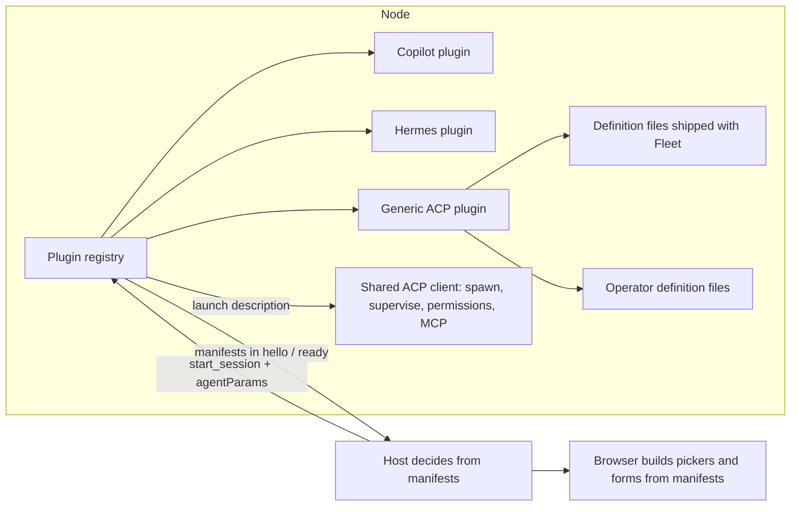

# Agent plugins: add agent kinds without changing Fleet's core

**Area**: Node agent launch, Host scheduling and settings, protocol  
**Engineer**: Not assigned  
**Driver / Approver**: Charles Yin, repository owner  
**Status**: Design approved in conversation; revised for review findings (2026-10-28); not implemented  
**Date**: 2026-10-26; revised 2026-10-28  
**Source baseline**: `bc268b8` on `main` (drafted at `3456c2a`; rechecked at `daed730` and `bc268b8`)  
**Work item**: Not supplied

## Related documents

| Document | Link |
| --- | --- |
| Current agent backends (Copilot + Hermes) | [orchestrator-agent-backend-plan.md](../../orchestrator-agent-backend-plan.md) |
| Earlier harness exploration | [2026-08-18-orchestrator-harness-choice.md](2026-08-18-orchestrator-harness-choice.md) |
| Earlier compile-time plugin plan (tunnels, not implemented) | [2026-08-20-tunnel-plugin-decoupling.md](../plans/2026-08-20-tunnel-plugin-decoupling.md) |
| Worker execution profiles | [2026-10-12-experimental-worker-model-routing.md](2026-10-12-experimental-worker-model-routing.md) |
| Task Node binding (designed in #104, not implemented) | [2026-10-26-task-node-binding-design.md](2026-10-26-task-node-binding-design.md) |
| Architecture | [ARCHITECTURE.md](../../../ARCHITECTURE.md) |
| ACP initialization and capabilities | [agentclientprotocol.com/protocol/initialization](https://agentclientprotocol.com/protocol/initialization) |
| ACP session config options | [agentclientprotocol.com/protocol/v1/session-config-options](https://agentclientprotocol.com/protocol/v1/session-config-options) |
| ACP agent list | [agentclientprotocol.com/get-started/agents](https://agentclientprotocol.com/get-started/agents) |
| Claude Code ACP adapter | [agentclientprotocol/claude-agent-acp](https://github.com/agentclientprotocol/claude-agent-acp) |
| Inspiration | [deepseek-ai/deepseek-harness](https://github.com/deepseek-ai/deepseek-harness) ("everything is a plugin") |
| Node.js batch-file argument handling | [CVE-2024-27980 security release](https://nodejs.org/en/blog/vulnerability/april-2024-security-releases-2) |

## Revision 2 (2026-10-28)

An independent design review raised six findings and three further
corrections. Each was checked against `main` at `bc268b8`, and each holds. One
qualification: today's launch arguments are fixed flags or validated names, so
the Windows launch weaknesses below cannot be reached from today's inputs.
Generic parameters would make them reachable, which is why fixing them comes
first. This revision changes the design as follows:

| Finding | Where it is resolved |
| --- | --- |
| P1. Older Nodes reject the new `agentParams` shape and close the whole connection | [Wire compatibility](#wire-compatibility) |
| P1. An ID-only deletion hook loses the existing deletion safeguards | [Native history deletion](#native-history-deletion) |
| P1. Windows command shims run arguments through `cmd.exe` | [Launching on Windows](#launching-on-windows) |
| P2. Managed-workspace allocation chooses its Node separately | [Agent eligibility](#agent-eligibility) |
| P2. A queued step rereads a profile that may have changed | [Selection snapshot](#selection-snapshot) |
| P2. Node-local process replacement assumes `session/load` works | [Process replacement](#process-replacement) |
| Parameter patterns can backtrack catastrophically | [Agent parameters](#agent-parameters) |
| The feature cache key ignores the definition's content | [Definition files](#definition-files) |
| Lint rules and a narrow context are not a security boundary | [Security](#security) |

Checking the findings turned up three more problems, fixed in the same places:

- The Windows managed launcher puts the whole command line inside a PowerShell
  single-quoted string. It escapes `'` but not `‘`, `’`, `‚` or `‛`, which
  PowerShell also treats as single quotes. A probe built the same way ended the
  string early and ran an injected command.
- Older Nodes also parse the full session records sent for the local session
  console (`session_console_grant`, and `session_console_update` messages that
  carry a session), and those records contain `agentParams`.
- Copilot CLI 1.0.105 does not advertise `sessionCapabilities.delete` in its ACP
  `initialize` response, and Fleet's retention deletion requires it. A
  hard-coded "Copilot supports cleanup" feature would therefore have been
  wrong for that version.

The phases now begin with a safety phase. The last phase runs a third agent
through the complete worker lifecycle, and only after it passes is
`@fleet/plugin-api` described as stable for external plugins.

## Summary

Fleet runs every session on Copilot except orchestrators, which may also run on
Hermes. Adding a third agent today means editing the protocol, the Host, the
Node and the UI: the merge that added Hermes (`b88e238`) touched 47 files, and
the literal `"hermes"` still appears in about 15 non-test files outside
`apps/node/src/agent-kinds/`.

This design turns agent kinds into plugins:

- Each Node describes the agent kinds it can run with **manifests**, small
  data-only records sent in its `hello`/`ready` inventory.
- The Host and browser make every decision from manifests and never branch on
  an agent kind's name.
- Agent kinds come from **built-in code plugins** (Copilot, Hermes) or from
  **definition files** run by one built-in generic ACP plugin. A
  definition file is enough for any agent that follows ACP well; Claude Code is
  the first.
- Plugin code may import only from a new `@fleet/plugin-api` package, so a later
  change can load plugins installed separately by operators without redesigning
  the contract. The package is versioned but stays internal until a third agent
  has completed the whole worker lifecycle (phase 6).
- The core keeps every safety-critical sequence: process launch, native history
  deletion, process replacement, synchronization and recovery. Plugins supply
  narrow agent-specific operations inside those sequences.
- Workers can use another agent kind through **execution profiles**, which gain
  an optional agent field.

## Why

Charles maintains Fleet as a personal project. If more people use it, requests
such as "support Codex" or "support Claude Code" will arrive faster than one
person can implement them. With this design such a request becomes a
definition file that one person can review, or a plugin folder that a
contributor owns, and it does not change Fleet's core.

## Decisions

These were agreed in conversation before this document was written.

| ID | Decision |
| --- | --- |
| D1 | **Built-in first, installable later.** Plugins ship inside the repository at first. Contracts are versioned and designed as if third parties will use them, so a later change can load installed packages. |
| D2 | **First project is the plugin foundation plus agent kinds.** Fleet tool plugins, themes and other plugin types get their own specs later. |
| D3 | **Orchestrators first, then workers**, in one spec, with behavior gated by declared features. |
| D4 | **Workers choose an agent kind through execution profiles.** A profile becomes agent kind + model + effort. Copilot stays the default. |
| D5 | **Two sources of agent kinds:** a generic ACP plugin that reads definition files, and code plugins for agents with special needs. |
| D6 | **Claude Code is the acceptance agent**, through `@agentclientprotocol/claude-agent-acp`. |
| D7 | **Approach A:** Nodes describe agent kinds with manifests; the Host stays generic; plugin code runs only on the Node. |

### Approaches considered

| | A. Nodes describe agent kinds (chosen) | B. Shared plugin list compiled into Host, Node and browser | C. Open the agent list and add one generic kind |
| --- | --- | --- | --- |
| Where plugin code runs | Node only | Node, Host and browser | Node only |
| Adding an agent from a definition file | No Fleet change | No Fleet change, but through a second path | No Fleet change |
| Adding a code plugin | Node release only | Host and Node release | Core edits across about 15 files |
| Mixed-version fleets | Safe; the Host reads what each Node declares | Host and Node must share a plugin list | Safe |
| Path to installable plugins | Replace the Node's loader | Needs loaders on three sides | None |

A matches the rule "Node owns execution" from ARCHITECTURE.md and keeps one
plugin API to stabilize instead of three.

## Terms

- **Agent kind**: which agent program a session runs (Copilot, Hermes, Claude
  Code). The code already uses `AgentKind`; this design keeps the name.
- **Manifest**: data a Node sends about one agent kind: identity, roles,
  parameters and features.
- **Code plugin**: a TypeScript module under `apps/node/src/plugins/<id>/` that
  implements an agent kind.
- **Definition file**: a JSON file describing an agent kind that speaks standard
  ACP, run by the generic ACP plugin.
- **Role**: a session's `runRole`: `""` (a plain session), `lead`
  (orchestrator), `worker` or `reviewer`.

## Architecture



1. When a Node starts and on each reconnect, its plugin registry runs every
   plugin's `detect()` and collects one manifest per available agent kind.
2. The Node sends the manifests in its inventory. The Host stores them per Node.
3. To start or resume a session, the Host sends `agentParams`. The Node finds
   the plugin, validates the parameters against the plugin's declared schema,
   and asks the plugin for a launch description.
4. The shared ACP client starts and supervises the process exactly as today.

**The core keeps ownership of:** process spawning, Windows Job Object
supervision and verified process-tree termination, permission answers, MCP
injection (including the per-session Fleet bearer), event sequencing, journaling
and replay suppression, native history deletion, process replacement, and wire
serialization. Plugins never spawn processes, so every agent kind gets the same
lifecycle guarantees.

**The Host and browser decide from manifests, not from names.** An agent kind's
name may appear in Host or UI code only where the code is about that agent's
own data or history, never to decide what a session may do. The allowed places
are:

1. The compatibility module that writes manifests for Nodes without
   `agent-plugins-v1` (see [Mixed versions](#mixed-versions)).
2. The rule that **Auto** means Copilot.
3. Cleanup and migration of existing usage records: the legacy Hermes
   usage source in `apps/host/src/usage-store.ts` and the Copilot credit
   backfill in `apps/host/src/usage-backfill.ts`.
4. Wording that explains a specific agent's own reporting, such as Copilot's
   input budget and `/context` text in `SessionUsageBar.tsx`. Phase 2 moves
   that wording behind manifest fields (`usage.*`) where a field exists, and
   keeps the rest in one labelled table.

The name check test reads an explicit list of allowed files from the test
itself. Any other Host or UI source file that contains an agent kind's name as
a string literal fails the build. Adding a file to the list is a reviewed
change. This check measures dependency discipline only. The safety of each
lifecycle is shown by the behavioral tests in [Testing](#testing).

## Contracts

### Manifest

Defined in `@fleet/plugin-api` and re-exported by `@fleet/protocol`. Zod
validates it; each manifest is limited to 8 KiB serialized and a Node sends at
most 32.

```ts
type AgentManifest = {
  apiVersion: 1;
  id: string;                    // ^[a-z][a-z0-9-]{1,39}$
  label: string;                 // display name, max 60 chars
  version?: string;              // detected program version, max 100 chars
  source: "builtin" | "definition";  // "installed" is reserved for later
  roles: Array<"" | "lead" | "worker" | "reviewer">;
  params: ParamSpec[];           // max 8
  features: {
    resume: boolean;             // session/load works
    httpMcp: boolean;            // can receive an HTTP MCP server
    unattended: "launch-flag" | "auto-approve" | "none";
    nativeHistoryCleanup: boolean; // the plugin can list and delete native history (see Native history deletion)
    nativeStateFiles: boolean;   // the plugin can name the native session folder downloads may read
    nativeLogSync: boolean;      // the plugin can import turns taken outside Fleet from the agent's own log
    adoptExisting: boolean;      // can attach to an existing native conversation
    images: boolean;             // accepts image prompt blocks
    usage: { context: boolean; tokens: boolean; credits: boolean };
    rollover: boolean;           // automatic recovery when the context window fills
    verified: boolean;           // resume, httpMcp and images were measured from ACP initialize
  };
  launchOptions: string[];       // Host-supplied options this kind accepts, e.g. "agency", "contextTier", "customAgent"
  setupHint?: string;            // max 300 chars
};

type ParamSpec = {
  key: string;                   // ^[a-z][a-zA-Z0-9]{0,31}$
  label: string;
  type: "string";
  format: "name" | "token" | "path" | "text";  // a fixed validator; see below
  maxLength: number;             // <= 128, and no larger than the format allows
  required: boolean;
  default?: string;
};
```

`copilot` and `hermes` are reserved IDs. A definition file may not use them.

A parameter names one of four fixed validators instead of a regular expression.
Each is a single-pass character check with no backtracking, and the same code
runs on the Host and the Node:

| Format | Accepts | Maximum length |
| --- | --- | --- |
| `name` | Lowercase letters, digits, `_` and `-`; starts with a letter or digit (today's Hermes profile rule) | 64 |
| `token` | Letters, digits, `.`, `_`, `-` and `:` | 128 |
| `path` | An absolute local path with no `..` segment | 128 |
| `text` | Printable characters, no control characters | 128 |

A definition file cannot supply its own pattern, so no input it accepts can
make validation slow.

### Agent parameters

`AgentParamsSchema` becomes generic in storage and inside the Host:

```ts
type AgentParams = { kind: string; params?: Record<string, string> };
```

- Legacy rows `{ kind: "hermes", profile }` parse and are normalized to
  `{ kind: "hermes", params: { profile } }` on read. A missing `agentParams` still
  means Copilot.
- The Host validates `params` against the target Node's manifest for usability.
  The Node validates again against the plugin's own schema and is authoritative.
- A plugin never receives an undeclared key. Values become whole argv elements
  or environment values, launched as described in
  [Launching on Windows](#launching-on-windows).
- The canonical shape is for storage, backups and Nodes with `agent-plugins-v1`.
  Older Nodes receive the legacy shape; see
  [Wire compatibility](#wire-compatibility).

### Code plugin API

```ts
export default definePlugin({
  apiVersion: 1,
  id: "hermes",
  async detect(ctx): Promise<AgentManifest | undefined> { ... },
  create(params, ctx): AgentKindAdapter { ... },
});
```

`ctx` provides: a scoped logger, the Node ID, a per-plugin configuration
directory under the Node config directory, `findCommand(name)` (PATH search,
from today's `findAgentCommand`), `runBounded(command, args, timeoutMs)` (from
today's `agentOutput`, launched the same way as sessions) and ACP helper types.
It does not hand the plugin the store, the router, the Host connection or the
process supervisor. This narrow context and the lint rule keep plugins
decoupled; they do not contain a plugin (see [Security](#security)).

`AgentKindAdapter` keeps the shape of today's `apps/node/src/agent-kinds/types.ts`
with these changes:

- `prepare()` returns a launch description: `command`, `args`, `env` additions,
  optional `notice`, and `failureMessage`. The core spawns.
- New optional `startupConfig(role)` returns initial session settings. Copilot
  returns today's `mode: agent` for leads and workers, which removes the
  Copilot-only branch from the Host's `startupConfigFor`.
- New optional `history`, present only when the manifest declares
  `nativeHistoryCleanup`. It offers `find(nativeSessionId)` and
  `remove(nativeSessionId)`, and nothing else. The deletion sequence and its
  safeguards stay in core; see
  [Native history deletion](#native-history-deletion).
- New optional `nativeStateDirectory(nativeSessionId)`, present only when the
  manifest declares `nativeStateFiles`. Copilot moves today's
  `<COPILOT_HOME>/session-state/<id>` rule from `apps/node/src/session-files.ts`
  here, so session downloads stop special-casing Copilot.
- New optional `nativeLog`, present only when the manifest declares
  `nativeLogSync`. It offers the Copilot-specific parts of today's
  `NativeSessionFollower` (`apps/node/src/native-session-sync.ts`): where the
  log is, how to parse a line, and how to find the processes holding the
  conversation. Ordering, sequence reservation, import acknowledgments and the
  router hooks stay in core, and the core follows a session only when its
  plugin provides `nativeLog`, so a non-Copilot session is never matched against
  Copilot's `session-state` folder.
- `usage`, `configOptions`, `setConfigOption`, `stderrLogLevel`, `rollover` and
  `tracksUnpromptedWork` remain optional hooks.

### Definition files

Read by the generic ACP plugin from two directories:

1. Shipped: `apps/node/agent-definitions/*.json` (in the package, outside `src/`).
2. Operator: `<Node config directory>/agent-definitions/*.json`.

An operator file with the same `id` replaces the shipped one, the same rule
`apps/node/src/agent-catalog.ts` uses for custom agents.

```json
{
  "apiVersion": 1,
  "id": "claude",
  "label": "Claude Code",
  "command": "claude-agent-acp",
  "args": [],
  "detect": { "versionArgs": ["--version"] },
  "roles": ["lead", "worker", "reviewer"],
  "params": [],
  "env": {},
  "unattended": { "approve": "allow_always" },
  "startupConfig": { "unattended": [] },
  "setupHint": "npm install -g @agentclientprotocol/claude-agent-acp, then sign in to Claude Code once as the user that runs the Node."
}
```

Rules:

- `command` is a program name found on PATH, or an absolute path to an
  executable. No shell expressions. On Windows it is launched under the rules
  in [Launching on Windows](#launching-on-windows): a native executable or npm
  shim takes any argument, and any other batch file takes only inert
  arguments.
- An `args` element is either literal text or exactly `{params.<key>}`, which
  is replaced by one declared parameter value as a whole argument.
- `env` is a map of names (`^[A-Z_][A-Z0-9_]{0,63}$`) to literal strings or
  `{params.<key>}`. Names used by Fleet itself (`FLEET_*`) and loader or library
  paths (`PATH`, `NODE_OPTIONS`, `LD_PRELOAD`, `DYLD_*`) are rejected.
- `startupConfig.unattended` lists `{ id, value }` ACP session settings applied
  when a session runs without permission prompts (YOLO). Each is applied only
  if the agent offers that option and value; otherwise the generic plugin
  answers permission requests with `allow_always`, then `allow_once`, as Hermes
  does today.
- **Features are measured, not declared.** On Node start and on each reconnect,
  before the inventory is sent, the generic plugin checks any definition with
  no cached result: it starts the agent, sends ACP `initialize`, records
  `loadSession`, `mcpCapabilities.http` and `promptCapabilities.image`, and
  closes it within the startup allowance.
- **The cache key is the whole effective launch.** It is a SHA-256 digest of
  the resolved executable path and that file's size and modification time, the
  arguments with parameter placeholders left unexpanded, the environment
  additions, and the detected version. Editing the command, arguments or
  environment, or replacing the program, forces a fresh check. An agent kind
  whose check fails or times out is left out of the manifests, and its error is
  listed on the Node config page.
- **Every launch checks again.** The capabilities the agent returns from
  `initialize` at each real start or resume are compared with what the session
  needs: `loadSession` for a resume, HTTP MCP when the session is given MCP
  servers. A shortfall ends the launch with an error naming the missing
  capability; it never runs with features silently missing.
- The inventory is sent only at connection time today, so a newly added or
  changed definition file reaches the Host on the Node's next reconnect;
  restarting the Node applies it at once.
- Generic agents report context usage from ACP `usage_update` notifications.
  Token and credit totals stay unknown (`?`) unless a code plugin reads the
  agent's own records. `nativeHistoryCleanup`, `nativeStateFiles`,
  `nativeLogSync`, `adoptExisting` and `rollover` are false.
- An invalid file is logged and listed with its exact validation error on the
  Node config page and in Settings → Agents. It never stops the Node from
  starting.

## Core-owned sequences

These sequences protect sessions, history and machines, so they stay in core.
Plugins answer narrow questions inside them.

### Wire compatibility

Nodes released before this change validate `agentParams` strictly. Their
schema accepts `{ kind: "copilot" }` and `{ kind: "hermes", profile }` only. A
frame that fails Node validation makes the Node close its whole connection,
which interrupts every session on that Node. A message type an older Node does
not know is refused the same way.

The Host therefore serializes per Node:

- **Storage, backups and the Host's own logic** use the canonical shape.
- **Every frame to a Node** passes through one function,
  `toNodeWire(message, node)`. Today frames leave the Host through
  `FleetService.send` and, for file reads, directly through the `NodeLink` in
  `apps/host/src/session-files.ts`. Every Node connection, sealed or legacy,
  is attached as a `NodeLink`, so the Host wraps each link when the Node is
  attached and the wrapper calls `toNodeWire` before every send. For a Node
  without `agent-plugins-v1` it rewrites every `agentParams` in the frame to the
  legacy shape: Copilot unchanged, Hermes as `{ kind: "hermes", profile }`.
- **Frames that cannot be expressed** in the legacy shape are never sent. A
  session whose agent kind is neither Copilot nor Hermes cannot be started,
  resumed, deleted or granted on an older Node. The Host refuses the action
  with a reason that names the Node's version, and drops the record from
  console updates to that Node. Placement already excludes such Nodes, because
  their compatibility manifests list only Copilot and Hermes.
- **A rewrite that fails is never sent.** If an unexpected value appears where
  the legacy shape has no room for it, the Host refuses that one action and
  logs it. It never sends the frame, because that would close the Node's whole
  connection.

The frames that carry `agentParams` today, each covered by the rewrite and by a
test:

| Frame | Field |
| --- | --- |
| `command` → `start_session` | `command.agentParams` |
| `command` → `resume_session` | `command.agentParams` |
| `command` → `delete_session` | `command.agentParams` |
| `session_console_grant` | `grant.session.agentParams` |
| `session_console_update` carrying a session | `message.session.agentParams` |

The rewrite works by walking the frame for any `agentParams` key, so a frame
added later is covered without being listed. A test fails if any
Host-to-Node schema embeds `AgentParamsSchema` in a path the rewrite does not
reach. Later fields that older Nodes reject, such as new launch options, are
added to the same function and gated by the capability that introduced them.

The Node's local session journal stores sessions it was granted, and compares
`agentParams` when a grant is renewed. A Node upgraded to `agent-plugins-v1`
normalizes stored records before comparing, so its first canonical grant does
not read as a conflicting binding.

**Compatibility tests** use frozen copies of the released Host-to-Node and
Node-to-Host schemas, saved under `packages/protocol/src/compat/` and never
edited afterwards. The suite checks that:

- start, resume, delete and console frames produced for an old Node parse under
  the frozen old schema, for Copilot and for Hermes;
- a Hermes session survives a Host upgrade, a Node reconnect, an automatic
  resume and a restore from backup while its Node is still old;
- a Claude Code session is refused for an old Node with the stated reason, and
  no frame is sent;
- a new Node's inventory parses under the frozen old Host schema.

### Native history deletion

Today's deletion has three layers of checks, and all three stay in core:

1. **The router** (`deleteSession` in `apps/node/src/router.ts`) computes the
   cutoff as the earlier of the Host's `inactiveBefore` and the Node's own
   retention setting, fences one deletion per session, refuses a session whose
   native ID changed, and makes a repeated request with the same identity
   succeed without deleting again.
2. **The final callback** (`beforeDelete`) runs immediately before deletion. It
   rechecks local inactivity, stops the retained process and verifies its
   termination, then rechecks inactivity once more.
3. **The native history check** (today inside `deleteInactiveSession` in
   `apps/node/src/copilot-sessions.ts`) reads the conversation's own fresh
   `updatedAt` from Copilot's session listing, never a cache, and refuses if it
   is newer than the cutoff or cannot be read.

Under this design the core runs the whole sequence. The plugin provides only
the two agent-specific operations:

```ts
interface NativeHistory {
  /** Fresh read with no cache; undefined when the conversation does not exist. */
  find(nativeSessionId: string): Promise<{ updatedAt: string } | undefined>;
  /** Deletes exactly this conversation. */
  remove(nativeSessionId: string): Promise<void>;
}
```

The core then:

1. applies the router checks as today;
2. calls `find()` and refuses if `updatedAt` is missing, unparseable or later
   than the cutoff;
3. runs the final callback;
4. calls `find()` again, so activity during steps 2 and 3 is caught, and
   refuses on the same terms;
5. calls `remove()` only if the conversation still exists;
6. records the deletion and acknowledges the Host with `session_cleanup_result`.

A plugin cannot skip a step, because it is never handed the sequence. A plugin
without `history` cannot be selected for deletion: the Host's retention sweep
skips sessions whose manifest lacks `nativeHistoryCleanup`, as it skips Hermes
today, and the Node refuses a deletion command for such a session.

`nativeHistoryCleanup` is declared only when the agent itself advertises the
ACP list and delete capabilities. Copilot CLI 1.0.105 advertises
`sessionCapabilities.list` but not `delete` (checked 2026-10-28), and Fleet's
deletion requires `delete`, so retention cleanup on that version refuses with
`unsupported_delete` today. The Copilot plugin therefore declares the feature
per detected version, from the agent's own `initialize` response, and the
retention sweep stops sending deletions that would be refused.

### Launching on Windows

Today's launcher (`copilotSpawnTarget` in `apps/node/src/copilot-launch.ts`)
starts any Windows command that is not an `.exe` or `.com` file with
`shell: true`. Node.js then joins the arguments into one `cmd.exe` command line
without escaping them, so `&`, `|` and similar characters in an argument run
commands. Without `shell: true`, Node.js refuses to start a `.cmd` or `.bat`
file at all (`EINVAL`, the CVE-2024-27980 fix). Quoting the executable path, or
passing arguments as an array, does not avoid `cmd.exe`'s parsing. The Copilot
session-listing connection (`openProcess` in `apps/node/src/copilot-sessions.ts`)
uses `shell: true` on Windows for every command, including `.exe` files.

The managed launcher (`spawnWindowsJob` in `apps/node/src/windows-process-job.ts`)
runs a session's process inside a Job Object. On Windows it is used for every
session that receives MCP servers, which includes every orchestrator, and every
session that holds a checkout lease or supervised repository participation.
With a shell it wraps the line in `cmd.exe /d /s /c`, which has the same
weakness. Separately, it embeds the whole command line in a PowerShell
single-quoted string and escapes `'` but not `‘`, `’`, `‚` or `‛`, which
PowerShell also treats as single quotes.

Today's arguments are fixed flags or validated names (Copilot's flags, Hermes's
profile name), so today's inputs cannot reach these weaknesses. Generic
parameters would. The new launch path, owned by core and used for every agent
launch, every bounded probe (`--version`, `--help`, `--check`) and the Copilot
session-listing connection:

1. **Native executables run directly.** An `.exe` or `.com` file is launched
   with `shell: false`. Arguments are quoted under the standard C runtime
   rules, which programs using the standard command-line parser read back
   unchanged.
2. **npm shims run their script directly.** A `.cmd` file whose content
   matches the template npm generates for a package's `bin` entry is not run.
   The core reads the target script path from it, checks that the script lies
   inside the shim's own directory tree, and launches the same `node.exe` the
   shim would use, with the script and the arguments, and `shell: false`.
3. **Other batch files accept only inert arguments.** Some agents install their
   own batch launcher; Hermes installs `hermes.cmd`. The core runs such a file
   through `cmd.exe` only when the batch path contains no `"`, `%`, `!` or
   control characters, and every argument consists only of letters, digits
   and `.`, `_`, `-`, `:`, `/` and `\`. `cmd.exe` gives none of those
   characters a meaning. Any other argument refuses the launch before anything
   starts, with an error that names the value's position, never the value.
   Hermes's arguments (`-p`, a validated profile name, `acp`, `--check`) fit.
4. **No values inside PowerShell source.** The managed launcher passes the
   command line, Job name and proof token to its PowerShell helper as Base64
   values in environment variables that only the helper reads, so no value is
   ever parsed as PowerShell. The Job Object, process-tree termination and
   quiescence proof are unchanged.
5. **Fail closed.** If a command cannot be launched under these rules, the
   launch fails with a clear error. There is no fallback to a shell.

Copilot keeps working: it is normally `copilot.exe`, and an npm installation is
launched through its shim's script. Agency (`agency.exe`) runs directly.

The same single-quote helper is copied in five other places
(`apps/node/src/command-supervisor.ts`, `scripts/self-update.mjs`,
`apps/host/src/data-permissions.ts`, `apps/host/src/corp-direct.ts`,
`apps/host/ui/src/lib/session-info.ts`). Those quote paths Fleet chooses, not
agent arguments, so they are fixed separately by one shared helper that also
doubles `‘`, `’`, `‚` and `‛`.

The literal-argument test runs on Windows for each launch form (native
executable, npm `.cmd` shim, other batch file, and the managed launcher) and on
Linux. It passes values containing `&`, `|`, `<`, `>`, `^`, `%VAR%`, `!`, `"`,
`'`, `‘`, `’`, `‚`, `‛`, spaces, parentheses and a trailing backslash. Each
value either reaches the agent unchanged or, for the other-batch-file form, is
refused before launch; in every case nothing else runs.

### Process replacement

The Node replaces an agent's process on its own in two cases. After the Node
reconnects to the Host, `refreshMcpSessions` restarts every idle session that
has MCP servers, and the router also restarts a session whose Fleet tools
disappeared mid-session. Separately, a context-window change restarts Copilot
with a different `--context` flag. Each path ends in `replaceAgent` in
`apps/node/src/router.ts`, which stops the current process first and then
starts a new one that loads the saved conversation with `session/load`. For an
agent kind without `resume`, that would end its only live conversation.

The policy:

- **Before any internal replacement**, the core checks the session's manifest.
  Without `resume`, the core keeps the current process and reports the
  condition instead: "Fleet tools are unavailable until this session is
  restarted; this agent cannot reload its conversation." The same check guards
  the context-window change, which only Copilot offers today.
- **Roles:** every orchestrator receives MCP servers, so the `lead` role
  requires `resume` as well as `httpMcp`. A worker or reviewer without
  `resume` can run, but it can never be parked and resumed. The Host marks it
  non-retainable: it is stopped when its step settles, and a follow-up starts
  a new worker rather than resuming it. If it receives forwarded MCP servers,
  the first rule keeps it running through a reconnect.
- **Every resume path checks `resume` first:** a Host resume, an automatic
  resume after reconnect, `fleet_follow_up`, Resume now, PR maintenance, and the
  Node's own replacement paths above.

### Agent eligibility

Whether a Node may run a session is decided by one function:

```ts
agentEligibility(node, { agentParams, role, needsMcp, unattended, resume })
  => { ok: true } | { ok: false; reason: string }
```

It is applied at all three points that choose or confirm a Node:

1. **Preliminary placement:** `decidePlacement` in
   `apps/host/src/orchestrator/schedule.ts`, used by the scheduler and by
   `fleet_start_work`.
2. **Managed-workspace allocation:** `executionPlacement` in
   `apps/host/src/managed-worktree-service.ts`, which picks the Node for a
   managed task's workspace before the checkout exists and can choose a
   different Node from step 1. Ineligible Nodes are removed from its candidate
   list before costs are compared.
3. **Final admission:** `createAndStartSession` in
   `apps/host/src/fleet-service.ts`, which confirms the Node again at launch.

Because allocation uses the same check, a managed checkout is never created on
a Node that cannot run the step's agent. If no candidate is eligible, the step
waits with the reason shown on the task page, and no workspace is requested.
Manifests can change between allocation and launch when a Node reconnects, so
admission still checks, and a refusal there puts the step back in the queue
with the reason. The workspace is kept for the next attempt.

### Selection snapshot

When `fleet_start_work` accepts a step, the Host resolves the agent and model
once and stores the result on the step:

```ts
type StepSelection = {
  version: 1;
  agentParams: AgentParams;          // resolved, canonical
  model: string | null;              // null = the agent kind's own default
  reasoningEffort: string | null;
  profileId?: string;
  policyRevision: number;            // worker-routing revision used
  source: "default" | "explicit" | "decision" | "single" | "fallback";
};
```

- It is written in the same transaction that creates the step, in a new
  `run_steps.selection` column. It travels in Host backups and survives
  restarts.
- Every launch of the step reads the snapshot, never the live profile. Editing
  or deleting a profile affects only steps accepted afterwards.
- It is recorded whether routing is on or off. The existing
  `WorkerRoutingReceiptSchema` accepts only modes `shadow` and `route`, so it
  stays as the record of the routing decision when one ran, and the snapshot is
  the record of what to launch.
- The snapshot is copied to the session (`agentParams`, plus the existing
  `workerSelection` for model and effort) when the session is created. From
  then on, follow-ups and resumes use the session's stored values, as today.
- A step accepted before this change has no snapshot and launches as today:
  Copilot, with the model and effort from its routing receipt when present.

## What moves where

| Today | After |
| --- | --- |
| `apps/node/src/agent-kinds/copilot*.ts`, Agency launch (`copilot-launch.ts`), credits and `/context` reader, native history listing and deletion in `copilot-sessions.ts` | `apps/node/src/plugins/copilot/`; history becomes the plugin's `find` and `remove`, and the deletion sequence moves into core |
| Native session log sync (`native-session-sync.ts`, merged in #105), wired in `main.ts` for every session; its router hooks (`beforeResume`, `nativeSession`, `launchingNative`, `turnEnded`) | Copilot plugin's `nativeLog` operations. The follower's ordering, acknowledgments and router hooks stay in core and run only for sessions whose manifest declares `nativeLogSync` |
| `apps/node/src/agent-kinds/hermes*.ts`, Hermes checks in `router.ts` (delete refusal, profile change refusal), Hermes branch in `usage-totals.ts` | `apps/node/src/plugins/hermes/`; `profile` becomes a declared parameter |
| `createAgentKind` switch, `detectAgentKinds` in `agent-kinds/index.ts` | `apps/node/src/plugins/registry.ts` |
| Generic helpers (`findAgentCommand`, `agentOutput`) | `@fleet/plugin-api` (search and probe) |
| `copilotSpawnTarget` (`shell: true` for Windows command shims), the session-listing connection's `shell: true`, and the managed launcher's `cmd.exe` wrapper and PowerShell string in `windows-process-job.ts` | Replaced by the core launch path in [Launching on Windows](#launching-on-windows) |
| Host `fleet-service.ts`: workers limited to Copilot, Copilot-only adopt, Agency and context tier, custom agent, startup config | Manifest checks: `roles`, `adoptExisting`, `launchOptions`, plugin `startupConfig` |
| Host `session-retention.ts` Hermes exclusion; `session-files.ts` Copilot-only native state access | `features.nativeHistoryCleanup`; `features.nativeStateFiles` with the plugin's `nativeStateDirectory` hook on the Node |
| UI `OrchestratorPanel.tsx` Hermes branches; labels in `SessionInfoDialog`, `SessionTile`, `TerminalView`, usage views | Generic picker and parameter form from manifests; `manifest.label` |
| `AgentKindSchema = z.enum(["copilot","hermes"])`, `agentKindLabels` | Open string ID plus manifests; labels from manifests |

Behavior that is about Copilot itself stays in the Copilot plugin and is reached
through existing optional hooks: the minimum version check, held-prompt and
unprompted-turn detection from Copilot's session log, and context rollover.
Router state that is generic today, such as capacity reservation and the rule
that a live session cannot change its agent kind or parameters, stays in the
core and compares the whole `agentParams` value instead of naming Hermes.

## Host and UI

### Host

- **Storage.** A new `nodes.agent_manifests` JSON column replaces
  `nodes.agent_kinds`. `FleetNode.agentKinds` is still derived from the
  manifests, for older clients.
- **Starting a session** goes through `agentEligibility` (see
  [Agent eligibility](#agent-eligibility)), which refuses when:
  - the target Node does not offer the agent kind;
  - the manifest does not allow the session's role;
  - the session needs Fleet's MCP server and `features.httpMcp` is false
    (orchestrators, and workers granted Host MCP forwarding);
  - the session is an orchestrator and `features.resume` is false;
  - the session runs without permission prompts and `features.unattended`
    is `"none"`;
  - `params` fail the manifest's validators.
- **Resume, automatic reconnect, retention, file downloads, Agency, context tier
  and custom agents** check manifest fields instead of names. A saved session
  always resumes on its stored agent kind and parameters. A missing agent kind
  blocks resume with the manifest's `setupHint`.
- **Orchestrator preference.** `orchestratorAgent` stores `AgentParams` in the
  new shape. The orchestrator route (`apps/host/src/routes/orchestrators.ts`)
  replaces `supportsAgentKind(node, kind)` with a manifest lookup. A new
  orchestrator falls back to Copilot, with the existing transcript notice, only
  when no online placement offers the preferred agent kind for the `lead` role.
  Lack of capacity is a refusal, as today, and a startup or sign-in error is
  reported, not hidden by a fallback.
- **Model defaults.** `orchestratorModels` becomes a map keyed by agent kind
  ID instead of the closed enum. Existing keys migrate unchanged.

### Choosing a worker's agent

- `WorkerExecutionProfileSchema` gains optional `agent: AgentParams`, and its
  `model` becomes optional (omitted means the agent kind's own default). A
  profile without `agent` means Copilot, so existing profiles are unchanged.
- **Behavior change:** when worker routing is Off, an explicit `profile` on
  `fleet_start_work` whose profile has an `agent` still applies as an explicit
  choice. No automatic decision runs and no provider is called. Profiles
  without `agent` keep today's Off behavior (ignored).
- The chosen agent, model, effort and policy revision are stored on the step
  when it is accepted (see [Selection snapshot](#selection-snapshot)), and every
  later decision reads that snapshot.
- Placement, managed-workspace allocation and final admission all apply
  `agentEligibility` with the snapshot's agent kind and the step's role
  (`worker` or `reviewer`). If no Node qualifies, the dispatch is refused with
  the reason, the same way an unknown profile is refused today. A Copilot
  worker is never substituted.
- If task Node binding (designed in #104) is implemented first, a task's
  workers can run only on its bound Node. The eligibility check then applies to
  that one Node, and a refusal names both facts: the task's bound Node, and
  that the Node does not offer the profile's agent kind.
- The profile's model list in Settings reads the model catalog reported by that
  agent kind.
- A worker keeps its stored agent kind and parameters for follow-ups and
  resumes. Editing a profile never changes a live worker or an accepted step.
- A worker whose agent kind lacks `resume` is not retained after its step
  settles (see [Process replacement](#process-replacement)).
- `fleet_get_worker_routing_policy` lists each profile's agent kind, so an
  orchestrator can choose, for example, to send reviews to Claude Code.

### UI

- **Settings → Agents** (new): each agent kind with the Nodes that offer it and
  their versions, its source, roles, verified features and setup hint, plus
  definition-file errors reported by Nodes.
- **Settings → Orchestrator → Preferred agent**: a generic picker over agent
  kinds offering the `lead` role, plus a form generated from the manifest's
  `params`. Replaces the Hermes profile field. A saved preference stays visible
  when no Node offers it, as today.
- **Worker model routing → profiles**: an Agent field (Copilot by default).
- **Session header, information dialog and usage**: show `manifest.label`.
  Unreported figures stay `?`.
- **Node config page**: detected agent kinds and definition-file errors.

## Mixed versions

- Nodes with this change advertise the capability `agent-plugins-v1` and send
  `agentManifests` in the inventory, alongside the existing `agentKinds`.
- For a Node without `agent-plugins-v1`, the Host compatibility module writes
  manifests: Copilot always, and Hermes when the Node reported it.
- An older Host does not know `agentManifests` and ignores it, because the
  inventory schema is a non-strict `z.object`. It keeps reading `agentKinds`.
- In the other direction, the Host rewrites every frame to an older Node into
  the legacy `agentParams` shape, and refuses actions it cannot express. See
  [Wire compatibility](#wire-compatibility); that section is the contract, and
  its frozen-schema tests are what prove it.
- Host backups carry the new `agentParams` shape, profile `agent` fields and
  step selection snapshots. Restoring an older backup normalizes legacy Hermes
  rows, and steps without a snapshot launch as they did before.

## Security

- **Code plugins are fully trusted Node code.** A code plugin runs inside the
  Node process and can import Node built-ins, so it can do anything the Node
  can: read files, start processes, reach the network and read the Node's
  credentials. The lint rule and the narrow `ctx` object keep plugins decoupled
  from the core; they do not contain a plugin. For now this costs nothing extra,
  because every code plugin ships in this repository and is reviewed like the
  rest of Fleet. An installable plugin would be equally trusted, which is why
  installing one needs its own design with an explicit trust step.
- **Definition files carry worker authority.** A file names a program, and that
  program gets full worker authority on the Node: YOLO, the session checkout
  and, for orchestrators, a Fleet MCP token. Only someone with access to the
  Node's config directory can add one. The Host cannot push definition files
  to Nodes, and agents cannot create them through Fleet.
- **What a definition file can express is limited**, because it is data the
  core interprets: one command, literal or placeholder arguments, a filtered
  environment, and parameters checked by fixed validators. The file itself
  adds no code to the Node process; the program it names runs as a separate
  process with the session's authority.
- **No command injection.** Parameter values pass fixed validators on the Host
  and again on the Node, and become whole argv elements. On Windows they reach
  the agent unchanged, or the launch is refused before anything starts; values
  are never interpreted by `cmd.exe` or PowerShell. See
  [Launching on Windows](#launching-on-windows). The literal-argument test
  covers every launch form.
- **Fleet records every unattended approval.** A generic agent's YOLO
  permissions are granted by Fleet's own permission handler
  (`requestPermission` in `apps/node/src/agents.ts`, which today auto-approves
  for Hermes). Phase 3 adds a transcript entry for each automatic approval,
  naming the tool call and the option chosen, because today those approvals
  leave no record.
- **Hard limits stay on the Host:** run budgets, `maxSessions`, read-only
  categories, checkout locks and maintenance holds. No agent kind can change
  them.
- **Read-only is still a label.** A plugin agent's reviewer is no more
  sandboxed than a Copilot reviewer; read-only remains a capacity label, not a
  filesystem guarantee.

## Phases

Each phase is a separate PR, in this order.

1. **Launch safety, with no new agents.** The core launch path from
   [Launching on Windows](#launching-on-windows) for Copilot, Agency, Hermes,
   the bounded probes and the Copilot session-listing connection, replacing
   `shell: true`, the `cmd.exe` wrapper and the PowerShell string embedding.
   Also the shared PowerShell quoting helper for the five other copies. This
   fixes the existing launcher for everyone and must ship before any generic
   parameter is accepted.
2. **Foundation, with no visible change.** `packages/plugin-api`; plugin
   registry; manifests in the inventory and `agent-plugins-v1`; the Host
   compatibility module and `agent_manifests` column; per-Node wire
   serialization with the frozen-schema tests; Copilot and Hermes moved into
   plugin folders; the deletion sequence, process-replacement policy and
   eligibility function moved into core; manifest checks replacing name checks
   in the Host and UI; the lint rule and the name check test.
3. **Generic ACP plugin and Claude Code as orchestrator.** Definition-file
   loading, fixed parameter validators, feature measurement with the
   launch-digest cache, per-launch capability checks, `claude.json`, the
   approval transcript entries, Settings → Agents and the generic
   preferred-agent picker.
4. **Workers through profiles.** Profile `agent` field, selection snapshots,
   eligibility in all three placement points, explicit choice with routing Off,
   non-retained workers for agents without `resume`, Settings profile editor,
   briefing and policy tool output.
5. **Documentation.** `docs/guide/agent-plugins.md` (writing a definition file
   and a code plugin), ARCHITECTURE.md, and a note at the top of
   `docs/orchestrator-agent-backend-plan.md` pointing to this design where they
   conflict.
6. **Complete third-agent lifecycle.** Run Claude Code through the full worker
   lifecycle on a real Node (AC-12). Until this passes, `@fleet/plugin-api` is
   internal and may change in any release; after it passes, version 1 is
   described as stable for plugins outside this repository.

## Acceptance criteria

| ID | Criterion |
| --- | --- |
| AC-01 | After phases 1 and 2, every existing Copilot and Hermes test passes unchanged, and the manual Hermes smoke exercise from the backend plan passes against the moved plugin. |
| AC-02 | After phase 2, no Host or UI source file outside the name check test's allow list contains `"copilot"` or `"hermes"` as an agent-kind literal, and no allowed use decides admission, scheduling, resume or retention. |
| AC-03 | Every built-in plugin and the generic ACP plugin pass the shared plugin test suite. |
| AC-04 | With a Node still on the previous release and a Host on this change, Copilot and Hermes sessions start, resume, reconnect, auto-resume, restore from backup and are cleaned up by retention; every frame sent to that Node parses under the frozen old schema. A new Node connected to an old Host keeps starting and resuming Copilot and Hermes sessions. |
| AC-05 | On a Node with `claude-agent-acp` installed and signed in, and with no Host code naming Claude: a Claude Code orchestrator starts, lists Fleet MCP tools, plans a task, dispatches a Copilot worker, is woken when the worker settles, stops, resumes from its saved conversation and accepts a follow-up. |
| AC-06 | An invalid operator definition file is listed with its error on the Node config page and in Settings → Agents, and the Node still starts and runs other agent kinds. |
| AC-07 | Arguments containing `&`, `\|`, `<`, `>`, `^`, `%VAR%`, `!`, `"`, `'`, `‘`, `’`, `‚`, `‛`, spaces, parentheses and a trailing backslash reach the agent unchanged through a native executable, an npm `.cmd` shim and the managed Job launcher on Windows, and on Linux. A batch file that is not an npm shim refuses each such value before launch. In no case does another command run. |
| AC-08 | After phase 4, an orchestrator dispatches a review with a `claude-review` profile; the reviewer runs on Claude Code on a Node that offers it, finishes, and its result settles the step. With routing Off the explicit profile still applies. |
| AC-09 | A dispatch naming a profile whose agent kind no online Node offers is refused with a reason naming the agent kind; no Copilot worker is started instead. |
| AC-10 | A Host backup made before this change restores with Hermes orchestrators and preferences intact. |
| AC-11 | Native history deletion refuses when the conversation's fresh `updatedAt` is newer than the cutoff at either check, when local activity appears before the final callback completes, when the native ID changed, and when the agent kind lacks `nativeHistoryCleanup`. A repeated request with the same identity succeeds without deleting again. |
| AC-12 | Phase 6: on a real Node, a Claude Code worker selected through a profile completes a step in a managed task, is parked when the checkout is needed, resumes for a follow-up, recovers Fleet MCP tools after a Host reconnect, and has its history refused for cleanup with the stated reason. |
| AC-13 | Placement, managed-workspace allocation and final admission agree: no managed checkout is created on a Node that cannot run the step's agent kind, and an eligibility refusal at admission leaves the step queued with its reason. |
| AC-14 | A step accepted with one profile launches with that selection after the profile is edited or deleted, after a Host restart, and after a backup and restore. |
| AC-15 | An agent kind without `resume` is never stopped for internal replacement: MCP recovery keeps the process and reports the condition, and a worker of that kind is not retained after its step settles. |
| AC-16 | Parameter validation of a 128-character input completes in under 1 ms for every format, and a definition file cannot supply its own pattern. |
| AC-17 | Changing a definition file's command, arguments or environment, or replacing its program, triggers a fresh feature check before the agent kind is offered again. |

## Testing

- **Shared plugin test suite (Vitest).** Runs each plugin against the fake ACP
  agents in `apps/node/src/fixtures/` (`managed-acp.mjs` and
  `fake-acp-agent.mjs`), extended to switch individual capabilities off. Checks
  manifest validity; `detect()` when the program is missing; parameter
  rejection; start, resume, stop, cancel and permission handling; YOLO
  approval; and refusal when a launch finds a capability missing.
- **Wire compatibility.** Frozen copies of the released Host-to-Node and
  Node-to-Host schemas under `packages/protocol/src/compat/`; every frame type
  that carries `agentParams` produced for an old Node and parsed under the
  frozen schema; the schema-walk test for new frames (AC-04).
- **Launch.** The literal-argument suite on Windows and Linux (AC-07); npm shim
  recognition and script containment; refusal of non-inert arguments to other
  batch files; the managed Job launcher with values passed outside PowerShell
  source, and its process-tree termination and quiescence proof, unchanged;
  Hermes's `hermes.cmd` launch and `--check` probe.
- **Deletion.** The cases in AC-11, using a fake history whose `updatedAt` and
  existence change between the two checks.
- **Host.** `agent_manifests` migration; backup round-trip (AC-10, AC-14);
  eligibility at all three placement points (AC-09, AC-13); selection snapshots
  (AC-14); profile behavior with routing Off; non-retained workers (AC-15).
- **Validators and cache.** The timing bound in AC-16; cache invalidation in
  AC-17.
- **UI.** The generic picker, parameter form, Settings → Agents and profile
  agent field.
- **Static.** The ESLint import rule and the name check test (AC-02). These
  check structure only; the behavioral tests above are what show the safety
  properties hold.
- **Manual.** AC-05, AC-08 and AC-12 on a machine with `claude-agent-acp`; the
  Hermes smoke exercise (AC-01).

## Verified facts this design relies on

- `@agentclientprotocol/claude-agent-acp` 0.97.0 (`main` on 2026-10-26)
  installs the `claude-agent-acp` command and advertises `loadSession: true`,
  `mcpCapabilities.http: true`, `promptCapabilities.image` and
  `embeddedContext`, sends `usage_update` notifications, and supports
  `session/set_config_option`. Its exact permission-mode setting for unattended
  sessions is pinned during phase 3; if no matching option exists, the generic
  plugin's auto-approval applies.
- Copilot CLI 1.0.105 (checked 2026-10-28) advertises `loadSession: true`,
  HTTP MCP, image prompts and `sessionCapabilities.list`, and does not
  advertise `sessionCapabilities.delete`.
- ACP requires clients to treat omitted capabilities as unsupported, and
  `initialize` returns the agent's capabilities, which makes measured features
  possible.
- The Node inventory schema (`nodeInventoryShape` in
  `packages/protocol/src/index.ts`) is a non-strict object, so older Hosts
  ignore new fields. Host-to-Node frames are the opposite: older Nodes reject
  what they do not recognize and close the connection.
- Node.js refuses to start a `.cmd` or `.bat` file without `shell: true`
  (`EINVAL`), and with `shell: true` it does not escape arguments. Windows
  PowerShell treats `‘`, `’`, `‚` and `‛` as single quotes. All three were
  reproduced on Node.js 26.12.1 and Windows PowerShell 5.1.
- Hermes on Windows is installed as a batch launcher, `hermes.cmd`, that is not
  an npm shim (checked 2026-10-28).

## Out of scope

- Installing plugins separately from Fleet, and any plugin marketplace.
- Host-side and browser plugins: Fleet tool plugins, themes and custom panels.
- Agents that do not speak ACP.
- Installing agents or signing them in automatically.
- Replacing ACP as the Node's agent transport.
- Core performance work; it goes through ordinary PRs and the existing
  `benchmark:*` scripts.
- Token or credit accounting for generic agents beyond ACP `usage_update`.
- A sandbox for read-only sessions.
- Per-Node differences in a definition file with the same ID; the Host shows the
  manifest each Node reports.
- Refreshing manifests during a live connection. A new message type for that
  would need its own capability gate; reconnect or restart is enough for now.

## Later plugin types (not designed here)

Recorded so later specs start from the same vocabulary:

- **Fleet tool plugins**: Host-side modules that register `fleet_*` MCP tools
  with an input schema, a scope check and a handler, replacing direct edits to
  `apps/host/src/orchestrator/mcp-routes.ts`.
- **Themes**: data files supplying the values in `apps/host/ui/src/theme.ts`
  (`fleetBrand`, overrides, `terminal`, `semanticColors`).
- **Installed plugins**: an operator-managed loader on the Node that accepts
  packages declaring `@fleet/plugin-api` version 1, with an explicit trust step.
  It waits for phase 6, and must treat an installed plugin as fully trusted
  Node code.
